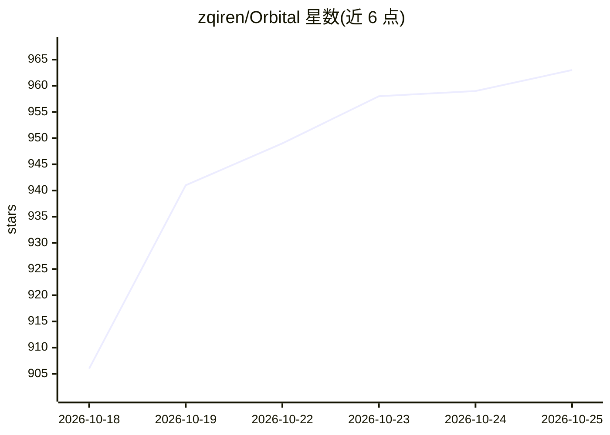

# zqiren/Orbital

⭐ 963 · Python · GPL-3.0 · 推送 2026-10-23 · [GitHub](https://github.com/zqiren/Orbital) · [官网](https://orbital.top/) · 个人维护 · 中文 README

**本地项目级 agent 编排器：统一项目上下文，任意 agent 可接续任务**

运行在用户本机的项目 agent 桌面应用（Windows/macOS 安装包，无需 Python 或 Node）：以项目而非会话为单位，将状态、决策、经验、任务队列与产物维护为项目文件夹内的纯文本文件，冷启动时组装进系统提示词。可编排 Claude Code、Codex、Gemini CLI、Cursor 等 CLI worker 执行任务并回收结果；任务队列强制 Completed/Blocked 终态。支持多 LLM 提供商接入（自带 API key），提供远程监督、预算控制与上下文压缩/前缀缓存。GPL-3.0 许可。

## 筛选速览

| 维度 | 判定 | 备注 |
|---|---|---|
| AI 角色 | `ai-ecosystem` | LLM/agent 周边工具 |
| 许可风险 | `viral` | GPL-3.0 |
| 部署形态 | `desktop` | 安装包/桌面程序 |
| 模型依赖 | locked-api |  |
| 硬件要求 | — | 无带数字的原话,不猜 |
| 安装摩擦 | `low` | 无编译、无系统依赖或容器化 |
| 成熟度 | — | 结构信号不足 |

## 能力要点

- 项目上下文以纯文件形式维护（PROJECT_STATE.md / DECISIONS.md / LESSONS.md / queue.json 等）
- 可注册任意 CLI agent 作为 worker（Claude Code、Codex、Cursor、Gemini CLI 等内置清单）
- 任务队列强制 Completed/Blocked 终态，未闭环任务会被重新提示
- v0.4.2 前缀缓存：系统提示词分段，宣称后续轮次约 95% 输入 token 命中前缀缓存

## 适用场景

- 一个 agent 用量耗尽后在同一对话中切换到另一个继续任务
- 多个 CLI agent 在同一项目上接续工作、共享决策与经验
- 排队任务后离开，回来查看完成或阻塞结果

## 场景标签

`Agent 框架` `Agent 记忆` · 领域:Agent 开发

## 证据(README 行号)

> L14:  Orbital is the context steward for your agents. It maintains your project's context so every agent works from the 
> L45: Orbital takes the context out of the session and puts it back in your local folder, and changes the unit of work fr
> L170: Orbital is not tied to a single AI tool. The project agent plans and delegates, while specialized workers execute 

## 星数曲线

2026-10-18 906 → 2026-10-25 963（+57）

---
*卡片 v1 · prompt 1.4 · 生成 2026-10-21 · 置信度 mid · 依据 README sha `c613f1b210f2` · [字段定义](../../DATASET.md)*
