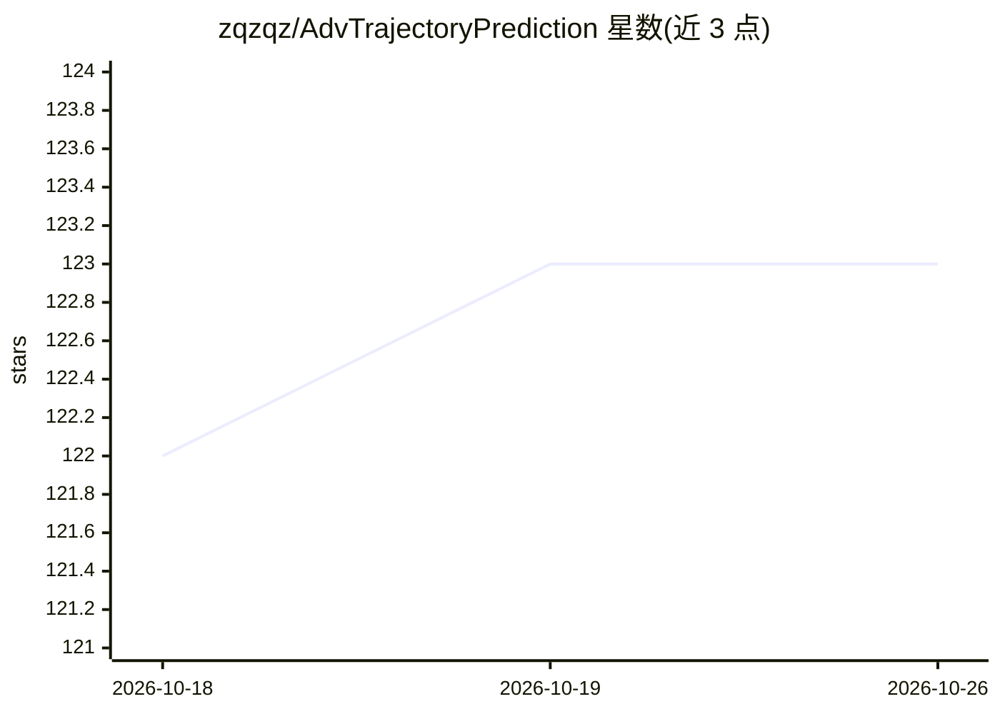

# zqzqz/AdvTrajectoryPrediction

⭐ 123 · Python · 推送 2026-10-08 · [GitHub](https://github.com/zqzqz/AdvTrajectoryPrediction) · 个人维护

**CVPR 2022 论文官方代码：自动驾驶轨迹预测的对抗鲁棒性分析**

实现论文《On Adversarial Robustness of Trajectory Prediction for Autonomous Vehicles》：对多种轨迹预测模型（GRIP++、FQA、Trajectron++）在 Apolloscape/NGSIM/nuScenes 数据集上执行对抗攻击与鲁棒性评估。支持白盒、黑盒攻击及多种防御（数据增强、训练时/测试时轨迹平滑、带检测的条件平滑），度量覆盖 ADE/FDE 及六个方向误差。提供公式化测试用例与预训练模型的 Google Drive 下载，训练代码不在本仓库；需 GPU（测试环境 CUDA 10.2 与 RTX 2080）。面向自动驾驶与机器学习科研人员复现实验或扩展自定义数据集/模型。

## 筛选速览

| 维度 | 判定 | 备注 |
|---|---|---|
| AI 角色 | `ai-native` | 本体是模型或模型工具 |
| 许可风险 | `none` | — |
| 部署形态 | `library` | 以包/库形式分发 |
| 模型依赖 | — | README 未给出锁定关系 |
| 硬件要求 | — | 无带数字的原话,不猜 |
| 安装摩擦 | `medium` | 含编译或系统依赖之一 |
| 成熟度 | — | 结构信号不足 |

## 能力要点

- 白盒/黑盒对抗攻击与 ADE/FDE 等多度量评估流程
- 三种预测模型与三个数据集的组合支持
- 数据增强与多级轨迹平滑防御模式（含带异常检测的测试时平滑）
- 提供自定义数据集与预测模型的扩展接口

## 适用场景

- 复现论文中的对抗攻击与防御实验
- 评估自动驾驶轨迹预测模型的对抗鲁棒性
- 扩展自己的数据集或预测模型做鲁棒性分析

## 场景标签

`科研工具` `模型评测` · 领域:评测与运维

## 证据(README 行号)

> L1: # Adversarial Robustness Analysis of Trajectory Prediction
> L23: - `attack_mode`: original (white box), augment (data augmentation), smooth (train-time trajectory smoothing), augme

## 星数曲线

2026-10-18 122 → 2026-10-26 123（+1）

---
*卡片 v1 · prompt 1.4 · 生成 2026-10-23 · 置信度 high · 依据 README sha `d59113ce7500` · [字段定义](../../DATASET.md)*
