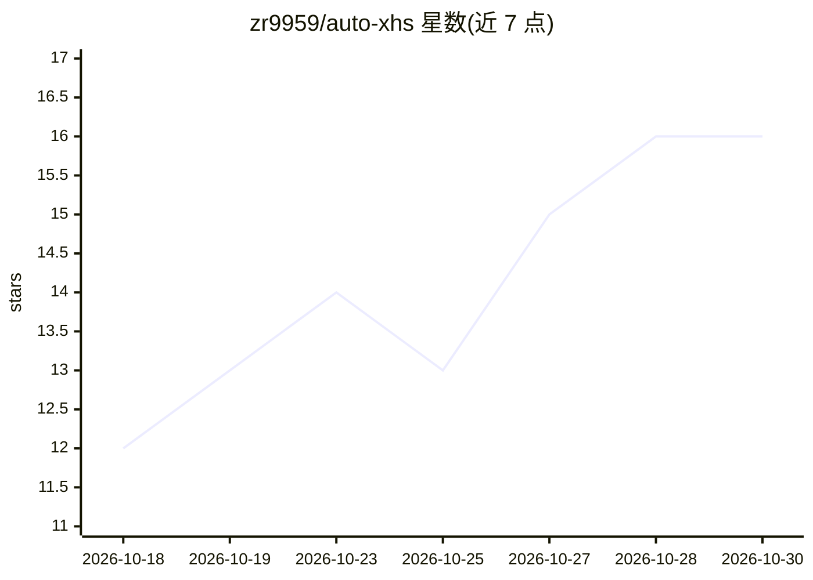

# zr9959/auto-xhs

⭐ 16 · Python · MIT · 推送 2026-10-25 · [GitHub](https://github.com/zr9959/auto-xhs) · 个人维护 · 中文 README

**让云端 AI agent 全自动运营小红书等多平台账号的开源系统**

开源的多平台社交账号自动化系统：用户将小红书账号登录到 AI agent（Muse / Dots / Grok Bot 三种云端助手）可用的浏览器后，agent 每日自行搜素材、写脚本、制作视频、发布并回复评论，全程在浏览器中以拟人点击完成，不使用非官方 API。默认平台为小红书，另提供抖音/TikTok、X、YouTube、微信公众号四个独立模块。视频以网页布局（HTML/CSS/GSAP）逐帧截图后由 ffmpeg 合成。支持全自动/半自动/手动三档；Muse 路径经作者端到端测试，Dots 与 Grok Bot 未测试。

## 筛选速览

| 维度 | 判定 | 备注 |
|---|---|---|
| AI 角色 | `ai-native` | 本体是模型或模型工具 |
| 许可风险 | `permissive` | MIT |
| 部署形态 | `None` |  |
| 模型依赖 | — | README 未给出锁定关系 |
| 硬件要求 | — | 无带数字的原话,不猜 |
| 安装摩擦 | `medium` | 含编译或系统依赖之一 |
| 成熟度 | — | 结构信号不足 |

## 能力要点

- 三种云端 AI agent（Muse / Dots / Grok Bot）接管从选题到发布、回评论的全链条
- 视频以网页+GSAP 动画逐帧截图、ffmpeg 合成，改数字改页面即可
- 发布前经验收脚本检查（字数、时长、分辨率、静音、封面、期号）
- 小红书之外提供抖音/TikTok、X、YouTube、微信公众号四个独立模块

## 适用场景

- 让 AI agent 每天自动找素材、做视频并发布到我的小红书账号
- 以半自动模式让 agent 准备成稿包、我审核后发布
- 用同一套流程扩展运营抖音、X、YouTube 等其他平台账号

## 场景标签

`浏览器自动化` `视频生成` · 领域:效率与自动化

## 证据(README 行号)

> L13: Auto-xhs is an open-source system that runs a Xiaohongshu (RedNote) account end to end — finding topics, writing sc
> L41: You log your own Xiaohongshu account into the browser your AI agent can use, once. After that, the agent takes over

## 星数曲线

2026-10-18 12 → 2026-10-30 16（+4）

---
*卡片 v1 · prompt 1.4 · 生成 2026-10-30 · 置信度 high · 依据 README sha `df132fe3ec38` · [字段定义](../../DATASET.md)*
