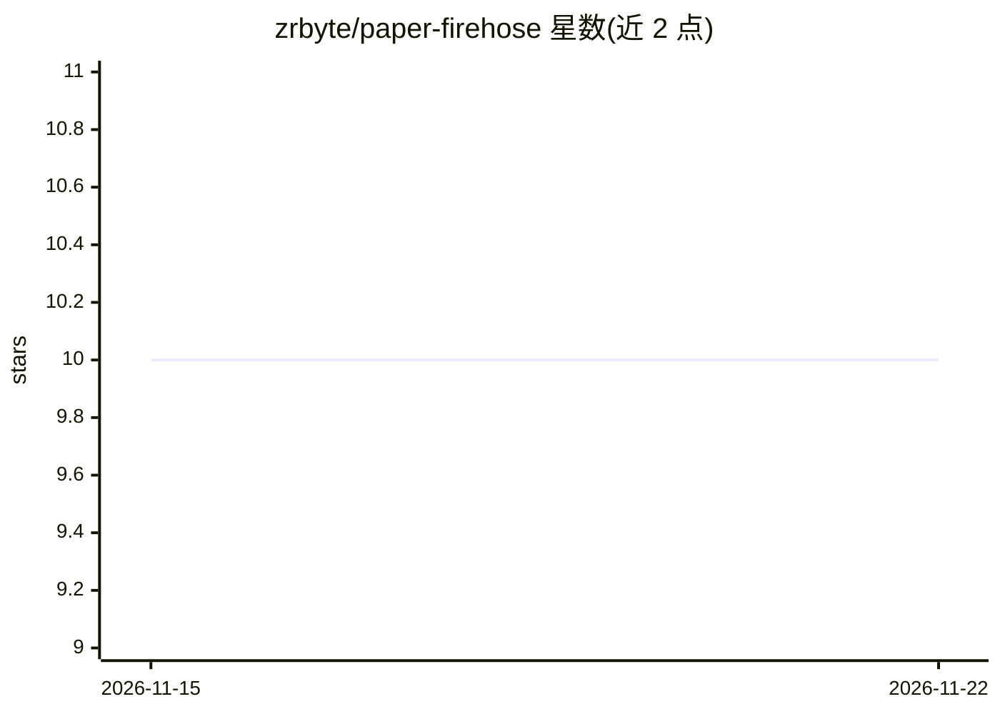

# zrbyte/paper-firehose

⭐ 10 · Python · MIT · 推送 2026-11-18 · [GitHub](https://github.com/zrbyte/paper-firehose) · 个人维护

**科研小组的论文追踪工具：RSS 过滤排名并生成 LLM 摘要**

面向需要追踪本领域新文献的科研人员：每日抓取 arXiv 与期刊 RSS，按 per-topic 正则过滤去重，用 Sentence-Transformers 嵌入对结果按关键词打分排序，写入 SQLite 数据库；可选调用 OpenAI 模型对高排名 arXiv PDF 全文生成摘要（JSON 含 summary/methods），并输出 HTML 页面或 SMTP 邮件摘要。配置全部为 YAML 文件，支持本地 pip 运行与 GitHub Actions 定时自动化部署。

## 筛选速览

| 维度 | 判定 | 备注 |
|---|---|---|
| AI 角色 | `ai-enhanced` | 去掉 AI 部分产品仍成立 |
| 许可风险 | `permissive` | MIT |
| 部署形态 | `library` | 以包/库形式分发 |
| 模型依赖 | — | README 未给出锁定关系 |
| 硬件要求 | — | 无带数字的原话,不猜 |
| 安装摩擦 | `low` | 无编译、无系统依赖或容器化 |
| 成熟度 | — | 结构信号不足 |

## 能力要点

- 正则过滤 + 嵌入模型相似度排序的两级论文筛选流水线
- arXiv PDF 本地抽取文本后单次调用模型生成全文摘要
- 输出 HTML 页面、SMTP 邮件摘要与 SQLite 数据库（含 FTS5 模糊查询与语义重排）
- 支持 pip 本地运行与 GitHub Actions 定时自动运行并发布页面

## 适用场景

- 每天 5 分钟内浏览本领域新论文的相关列表
- 让课题组定时收到按相关度排序的邮件论文摘要
- 为某个研究方向建立自动更新的论文发布页

## 场景标签

`科研工具` · 领域:学习与行业

## 证据(README 行号)

> L3: Being well read is a pillar of good science, but the volume of new papers makes it impossible to truly keep up to da
> L5: Matched papers get stored in an SQLite database. Based on this one can generate HTML pages or an email digest. Optio
> L76:  - Compute `rank_score` using Sentence‑Transformers similarity to `ranking.query`.

## 星数曲线

2026-11-15 10 → 2026-11-22 10（+0）

---
*卡片 v1 · prompt 1.4 · 生成 2026-11-19 · 置信度 high · 依据 README sha `bcbdbd7d2675` · [字段定义](../../DATASET.md)*
