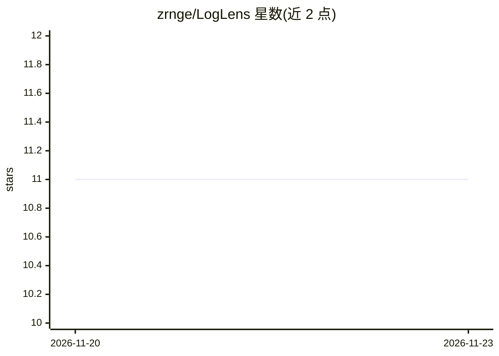

# zrnge/LogLens

⭐ 11 · HTML · MIT · 推送 2026-04-11 · [GitHub](https://github.com/zrnge/LogLens) · [官网](https://zrnge.github.io/LogLens/) · 个人维护

**浏览器内运行的本地日志探索器，配 Ollama AI 分析**

单 HTML 文件实现的通用日志浏览器，完全在浏览器本地运行：支持 KQL 查询（布尔逻辑、通配符、正则）、时间线直方图与字段分布可视化，虚拟滚动处理 50 万行以上日志。读取 JSON/CSV/Syslog/Apache/CEF/GELF/Windows Event XML 等 15 种格式，二进制 .evtx 给出 PowerShell 转换指引。内置本地 AI 分析面板，经 Ollama 连接本地模型（需设 OLLAMA_ORIGINS 允许 CORS），提供错误分析、事件报告、根因定位、安全审计等功能，AI 请求注入当前过滤状态与最多 100 条日志样本。无后端、无依赖、MIT 许可。

## 筛选速览

| 维度 | 判定 | 备注 |
|---|---|---|
| AI 角色 | `ai-enhanced` | 去掉 AI 部分产品仍成立 |
| 许可风险 | `permissive` | MIT |
| 部署形态 | `None` |  |
| 模型依赖 | local-ok | 支持本地模型 |
| 硬件要求 | — | 无带数字的原话,不猜 |
| 安装摩擦 | `low` | 无编译、无系统依赖或容器化 |
| 成熟度 | — | 结构信号不足 |

## 能力要点

- KQL 查询引擎（布尔逻辑、范围、通配符、正则）
- 支持 JSON/CSV/Syslog/CEF/GELF/Windows Event XML 等 15 种日志格式
- Ollama 本地 AI：分析、报告、KQL 提示、根因、安全审计
- 虚拟滚动处理 500k+ 行日志，无后端无依赖

## 适用场景

- 离线/内网环境下本地浏览和查询日志文件
- 运维排障时让本地 AI 生成事件报告和根因假设
- 安全事件响应中审计可疑 IP、暴力破解等行为
- 读取 Windows 事件日志等多格式日志做统一检索

## 场景标签

`网络安全` · 领域:学习与行业

## 证据(README 行号)

> L15: **LogLens** is a universal log explorer that runs entirely in your browser. Drop any log file in, query it with KQL
> L67: ### 🤖 Local AI Analyst
> L70: Powered by Ollama, the AI panel lets you chat with your logs:

## 星数曲线

2026-11-20 11 → 2026-11-23 11（+0）

---
*卡片 v1 · prompt 1.4 · 生成 2026-11-20 · 置信度 high · 依据 README sha `2c9c9055e7a2` · [字段定义](../../DATASET.md)*
