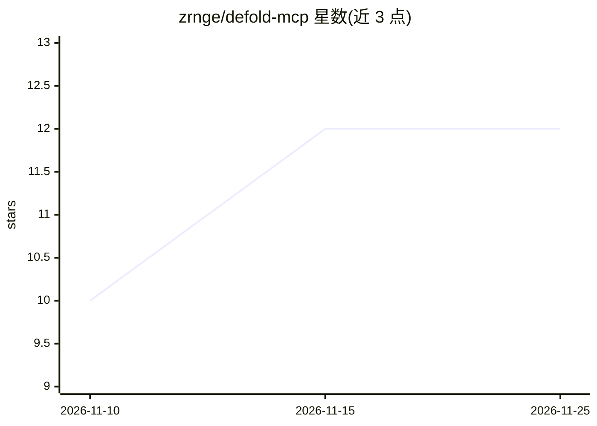

# zrnge/defold-mcp

⭐ 12 · TypeScript · 推送 2026-08-16 · [GitHub](https://github.com/zrnge/defold-mcp) · 个人维护

**让 AI 编码代理检查、编辑、构建和调试本地 Defold 游戏项目的 MCP 服务器**

基于 TypeScript 的 Model Context Protocol 服务器，将本地 Defold 游戏项目通过结构化 MCP 工具暴露给 AI 编码代理，覆盖项目检查、Lua 脚本读写与补丁、集合/游戏对象/GUI 修改、语法校验、构建运行与进程输出读取等约 30 个工具。安全模型将操作限制在项目根目录内，破坏性操作需 confirm 参数。需 Node.js 20+，构建运行集成依赖本地 Defold 安装（bob.jar）。提供 Claude Code、Cursor、VS Code 等客户端的接入配置说明。

## 筛选速览

| 维度 | 判定 | 备注 |
|---|---|---|
| AI 角色 | `ai-ecosystem` | LLM/agent 周边工具 |
| 许可风险 | `none` | — |
| 部署形态 | `library` | 以包/库形式分发 |
| 模型依赖 | — | README 未给出锁定关系 |
| 硬件要求 | — | 无带数字的原话,不猜 |
| 安装摩擦 | `low` | 无编译、无系统依赖或容器化 |
| 成熟度 | — | 结构信号不足 |

## 能力要点

- 约 30 个 MCP 工具覆盖读、写、危险操作（需 confirm）、构建运行四类
- 构建→错误解析→补丁→校验→运行的调试闭环工作流
- 项目根目录路径校验、拒绝路径穿越与 symlink 逃逸的安全模型
- 提供 Claude Code/Cursor/VS Code 的 stdio 接入配置

## 适用场景

- 让 AI 编码代理直接修改和调试本地 Defold 游戏项目
- 通过构建-运行-读取输出的循环让 AI 自主修复构建与运行时错误
- 用 AI 批量搜索、分析 Lua 脚本与资源依赖关系

## 场景标签

`编码 Agent` · 领域:编码与开发

## 证据(README 行号)

> L3: A production-quality Model Context Protocol (MCP) server that gives AI coding agents comprehensive control over a lo
> L7: Defold MCP exposes Defold projects through structured MCP tools so an AI agent can:
> L15: - Build and run the project through a local Defold installation

## 星数曲线

2026-11-10 10 → 2026-11-25 12（+2）

---
*卡片 v1 · prompt 1.4 · 生成 2026-11-18 · 置信度 high · 依据 README sha `4c392a6842a5` · [字段定义](../../DATASET.md)*
