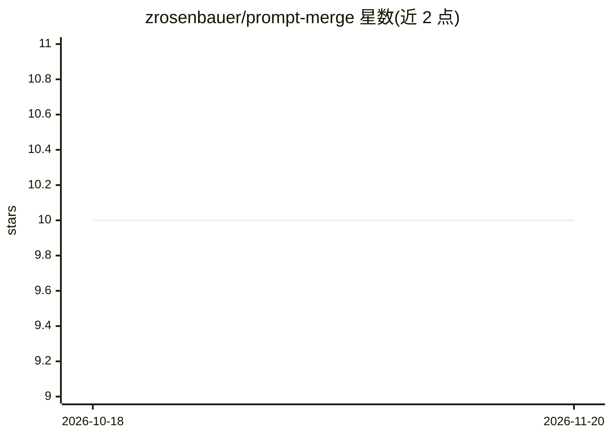

# zrosenbauer/prompt-merge

⭐ 10 · TypeScript · MIT · 推送 2025-11-24 · [GitHub](https://github.com/zrosenbauer/prompt-merge) · [官网](https://npmjs.com/prompt-merge) · 个人维护

**按条件合并 LLM 系统提示词的零依赖 JS 库**

零依赖的 JavaScript/TypeScript 库，用于按条件将 LLM（system）提示词合并为单个字符串。安装后通过 import 引入，示例中与 Vercel AI SDK 的 generateText 搭配使用；设计思路借鉴 classnames 与 tailwind-merge 这类字符串组合工具，把提示词当作字符串做条件拼接。面向在前端/Node 项目中组装提示词的开发者。

## 筛选速览

| 维度 | 判定 | 备注 |
|---|---|---|
| AI 角色 | `ai-ecosystem` | LLM/agent 周边工具 |
| 许可风险 | `permissive` | MIT |
| 部署形态 | `library` | 以包/库形式分发 |
| 模型依赖 | — | README 未给出锁定关系 |
| 硬件要求 | — | 无带数字的原话,不猜 |
| 安装摩擦 | `low` | 无编译、无系统依赖或容器化 |
| 成熟度 | — | 结构信号不足 |

## 能力要点

- 零依赖，npm install 即可安装
- 按条件合并多条 LLM/system 提示词为单个字符串
- TypeScript 示例，可与 Vercel AI SDK 配合使用

## 适用场景

- 在调用 LLM 前按条件拼装 system prompt
- 替代手写模板字符串拼接管理提示词片段

## 场景标签

`提示工程` · 领域:Agent 开发

## 证据(README 行号)

> L9: Zero-dependency library for conditionally merging LLM (system) prompts into a single string.
> L20: import pm from "prompt-merge";

## 星数曲线

2026-10-18 10 → 2026-11-20 10（+0）

---
*卡片 v1 · prompt 1.4 · 生成 2026-11-19 · 置信度 high · 依据 README sha `496938937fd6` · [字段定义](../../DATASET.md)*
