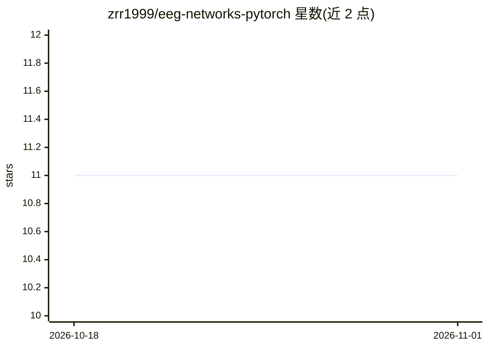

# zrr1999/eeg-networks-pytorch

⭐ 11 · Python · 推送 2026-10-30 · [GitHub](https://github.com/zrr1999/eeg-networks-pytorch) · 个人维护 · 中文 README

**基于 PyTorch 的 EEG 分类神经网络实现库**

提供多种用于脑电（EEG）信号分类的神经网络实现的 Python 库，基于 PyTorch 构建。目前已实现 eeg-inception 与 eeg-lstm，eeg-gcn 列于计划中。支持通过 PyPI 安装或克隆源码安装依赖，附 train.py 与 val.py 脚本用于模型训练与验证，训练示例使用 GIB-UVa ERP-BCI 数据集，可指定设备（如 CPU）与模型权重路径。

## 筛选速览

| 维度 | 判定 | 备注 |
|---|---|---|
| AI 角色 | `ai-native` | 本体是模型或模型工具 |
| 许可风险 | `none` | — |
| 部署形态 | `library` | 以包/库形式分发 |
| 模型依赖 | — | README 未给出锁定关系 |
| 硬件要求 | — | 无带数字的原话,不猜 |
| 安装摩擦 | `low` | 无编译、无系统依赖或容器化 |
| 成熟度 | — | 结构信号不足 |

## 能力要点

- 已实现 eeg-inception 与 eeg-lstm 两种 EEG 分类网络
- 提供 train.py / val.py 训练与验证脚本，支持命令行参数
- 支持 pip 安装（eeg-networks）或源码克隆使用

## 适用场景

- 在 EEG / BCI 任务上训练与验证深度学习分类模型
- 作为 PyTorch 环境下的 EEG 网络实现参考

## 场景标签

 · 领域:脑机接口/信号分类

## 证据(README 行号)

> L5: Implementation of various simple networks for EEG classification tasks based on PyTorch.
> L36: python train.py --model_name inception --device cpu --dataset_path ./GIB-UVA ERP-BCI.hdf5 --model_path ./weights

## 星数曲线

2026-10-18 11 → 2026-11-01 11（+0）

---
*卡片 v1 · prompt 1.4 · 生成 2026-11-01 · 置信度 high · 依据 README sha `941fd0941686` · [字段定义](../../DATASET.md)*
