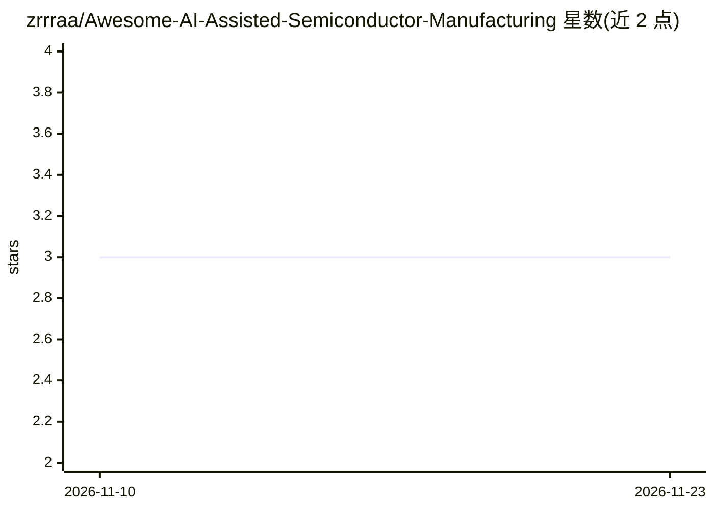

# zrrraa/Awesome-AI-Assisted-Semiconductor-Manufacturing

⭐ 3 · Python · 推送 2026-10-28 · [GitHub](https://github.com/zrrraa/Awesome-AI-Assisted-Semiconductor-Manufacturing) · [官网](https://zrrraa.github.io/Awesome-AI-Assisted-Semiconductor-Manufacturing/) · 组织维护 · 中文 README

**AI 辅助半导体制造论文集：从感知到自主的分阶段调研**

浙江大学集成电路学院团队为其综述论文维护的策展论文集，围绕五个制造范围（制程、工艺、设备、生产、工厂）与十九个任务组织条目，每条记录会议/期刊、作者、论文与资源链接，并标注所属 AI 阶段（感知、预测、推理、规划、自主）。提供按任务浏览、阅读指南、交互式论文库与完整文献目录，接受社区投稿补充条目，并附 BibTeX 引用信息。

## 筛选速览

| 维度 | 判定 | 备注 |
|---|---|---|
| AI 角色 | `ai-knowledge` | 知识聚合/清单类 |
| 许可风险 | `none` | — |
| 部署形态 | `None` |  |
| 模型依赖 | — | README 未给出锁定关系 |
| 硬件要求 | — | 无带数字的原话,不猜 |
| 安装摩擦 | `low` | 无编译、无系统依赖或容器化 |
| 成熟度 | — | 结构信号不足 |

## 能力要点

- 五个制造范围 × 十九个任务的组织结构，每条目含 venue/作者/资源链接与 AI 阶段标注
- 五阶段分类：Perception、Prediction、Reasoning、Planning、Autonomy
- 提供交互式项目页、阅读指南与完整文献目录
- 开放社区投稿（Pull requests welcome）

## 适用场景

- 查找特定半导体制造任务（如缺陷检测、计算光刻）的相关论文
- 按 AI 阶段梳理制造领域研究脉络
- 新入领域者按阅读指南系统了解研究方向

## 场景标签

`精选清单` · 领域:学习与行业

## 证据(README 行号)

> L2:  From Perception to Autonomy: A Survey on AI-Assisted Semiconductor Manufacturing
> L23: How can AI move from recognizing a defect to coordinating a factory? Semiconductor manufacturing connects processes
> L55: Choose a manufacturing question and follow its research. Each entry includes the venue, authors, paper and resource

## 星数曲线

2026-11-10 3 → 2026-11-23 3（+0）

---
*卡片 v1 · prompt 1.4 · 生成 2026-11-21 · 置信度 high · 依据 README sha `e0a90ebc3665` · [字段定义](../../DATASET.md)*
