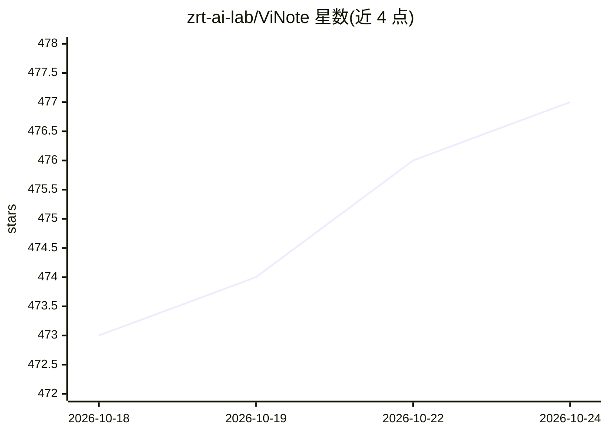

# zrt-ai-lab/ViNote

⭐ 477 · Python · MIT · 推送 2026-09-05 · [GitHub](https://github.com/zrt-ai-lab/ViNote) · 组织维护 · 中文 README

**开源视频知识 Agent：视频转笔记、问答、卡片与导图**

FastAPI + React 的自托管 Web 应用，面向个人用户的单机视频知识管理工具：粘贴 YouTube/Bilibili 链接或本地视频路径，经 Faster-Whisper（可选 FunASR/Qwen3）本地转写后生成结构化 Markdown 笔记、摘要、知识卡片与 Markmap 思维导图，支持基于视频内容的问答与全文检索。ViNoter 对话式智搜基于 DeepSeek Harness SDK 编排视频搜索与笔记工具，模型侧要求任意 OpenAI 兼容接口（需支持流式与工具调用），无需 DeepSeek 账号。数据存 SQLite，会话可刷新恢复；默认 CPU 转写，Docker 或本地脚本部署。限制：单用户、无账号隔离，Agent 任务不自动续跑。

## 筛选速览

| 维度 | 判定 | 备注 |
|---|---|---|
| AI 角色 | `ai-native` | 本体是模型或模型工具 |
| 许可风险 | `permissive` | MIT |
| 部署形态 | `desktop` | 安装包/桌面程序 |
| 模型依赖 | — | README 未给出锁定关系 |
| 硬件要求 | `cpu-ok` | |
| 安装摩擦 | `low` | 无编译、无系统依赖或容器化 |
| 成熟度 | — | 结构信号不足 |

## 能力要点

- B站/YouTube 检索、下载、转写到笔记生成全流程串联
- Faster-Whisper 本地转写，可选 FunASR/Qwen3 引擎
- ViNoter 智搜：基于 DeepSeek Harness SDK 的工具编排，OpenAI 兼容模型即可使用
- 笔记、问答会话与智搜上下文 SQLite 持久化，支持刷新/重启后恢复
- 知识卡片、Markmap 思维导图与 11 种摘要语言

## 适用场景

- 把 YouTube/B站 教学视频整理成结构化笔记用于复习
- 基于视频转录内容提问并延续多轮问答
- 批量处理合集视频（最多 20 个）建立可检索的视频知识库
- 对话式搜索视频并直接生成笔记

## 场景标签

 · 领域:知识管理/视频内容处理

## 证据(README 行号)

> L29: - **高质量转录**: 基于 Faster-Whisper 的本地音频转录
> L41: - **智能问答**: 基于视频内容的AI问答系统
> L217: |DeepSeek Harness SDK|模型调用与工具编排，只开放 `video_search`、`generate_notes` 两个业务工具|

## 星数曲线

2026-10-18 473 → 2026-10-24 477（+4）

---
*卡片 v1 · prompt 1.4 · 生成 2026-10-21 · 置信度 high · 依据 README sha `b678673fd52b` · [字段定义](../../DATASET.md)*
