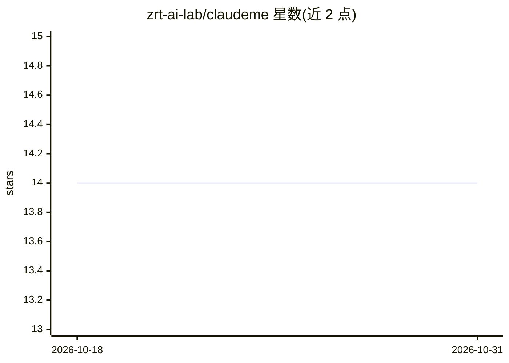

# zrt-ai-lab/claudeme

⭐ 14 · TypeScript · 推送 2026-07-06 · [GitHub](https://github.com/zrt-ai-lab/claudeme) · 组织维护 · 中文 README

**终端 AI 编程助手：Claude Code 分支，接任意 OpenAI 兼容 API**

基于 Claude Code 的分支版本，面向中文开发者。核心改动：解绑 Anthropic SDK，通过 OpenAI 适配器接入任意 OpenAI Compatible API（阿里云、火山引擎、Moonshot、DeepSeek 等），按厂商分组配置多模型；默认 Bypass Permissions 零确认模式；界面与提示信息中文化。保留原版工具链（文件读写、Bash 执行、代码搜索、MCP），并新增 Wiki 个人知识库（LLM 提取实体/主题、双向链接、两阶段 RAG 查询）与实时状态栏（模型、上下文进度、token 用量）。运行于 Bun 运行时，通过 git clone + bun install 安装，与原版 Claude Code 配置目录隔离可共存。

## 筛选速览

| 维度 | 判定 | 备注 |
|---|---|---|
| AI 角色 | `ai-native` | 本体是模型或模型工具 |
| 许可风险 | `none` | — |
| 部署形态 | `None` |  |
| 模型依赖 | — | README 未给出锁定关系 |
| 硬件要求 | — | 无带数字的原话,不猜 |
| 安装摩擦 | `low` | 无编译、无系统依赖或容器化 |
| 成熟度 | — | 结构信号不足 |

## 能力要点

- 解绑 Anthropic SDK，接入任意 OpenAI Compatible API，多厂商多模型分组配置
- 默认 Bypass Permissions 零确认模式，工具调用自动放行
- Wiki 个人知识库：LLM 提取实体/主题、双向链接、两阶段 RAG 查询、SHA256 去重
- 中文 UI 与实时状态栏（模型、上下文进度条、token 用量与费用）

## 适用场景

- 在国内网络环境直连国内大模型平台进行 AI 辅助编程
- 在同一台机器上与原版 Claude Code 并存使用多厂商模型
- 把个人技术文档与笔记构建为终端内可查询的 Wiki 知识库

## 场景标签

`编码 Agent` `知识库管理` · 领域:编码与开发

## 证据(README 行号)

> L3: > 基于 Claude Code，极简、不闹心的终端 AI 编程助手。解绑官方 SDK，支持任意 OpenAI Compatible API，零确认开干。
> L24: - ✅ **不限制** —— 解绑 Anthropic SDK，接任意 OpenAI Compatible API
> L39: |🧠 Agent 能力|多 Agent 并行、子任务编排、Plan 模式、自动化工作流|

## 星数曲线

2026-10-18 14 → 2026-10-31 14（+0）

---
*卡片 v1 · prompt 1.4 · 生成 2026-10-31 · 置信度 high · 依据 README sha `aa7cf8fe6d18` · [字段定义](../../DATASET.md)*
