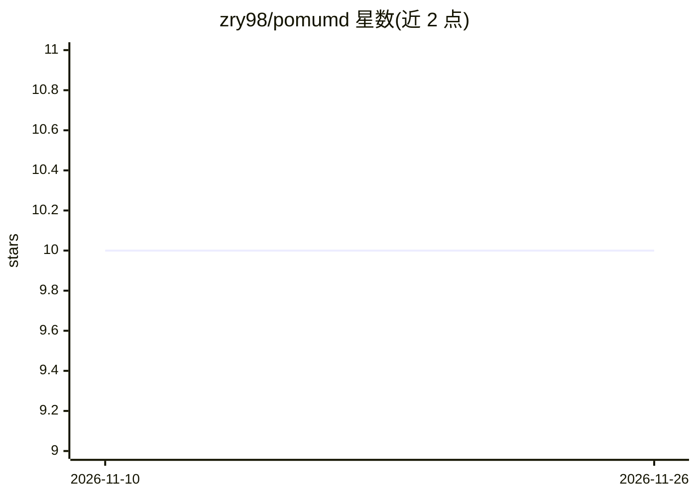

# zry98/pomumd

⭐ 10 · Swift · MIT · 推送 2026-02-12 · [GitHub](https://github.com/zry98/pomumd) · 个人维护

**iOS/macOS 设备本地运行的 Wyoming TTS/STT 与 LLM 服务器**

基于 iOS AVFoundation 与 Speech 框架的 Wyoming Protocol 语音服务器，同时提供 OpenAI Conversation API 兼容的 MLX LLM 服务器，全部在本机处理。TTS 走 AVSpeechSynthesizer，支持 60 余种语言与多种音色、部分 SSML 标签及流式输出；STT 在新系统用 SpeechTranscriber、旧系统用 SFSpeechRecognizer。通过 mDNS Zeroconf 供 Home Assistant 自动发现，附健康检查与 Prometheus 指标端点。项目处于早期开发阶段，接口可能频繁变更；无 LLM 的 lite 版支持 iOS 16+/macOS 13+。

## 筛选速览

| 维度 | 判定 | 备注 |
|---|---|---|
| AI 角色 | `ai-native` | 本体是模型或模型工具 |
| 许可风险 | `permissive` | MIT |
| 部署形态 | `None` |  |
| 模型依赖 | — | README 未给出锁定关系 |
| 硬件要求 | — | 无带数字的原话,不猜 |
| 安装摩擦 | `low` | 无编译、无系统依赖或容器化 |
| 成熟度 | `idea` | |

## 能力要点

- Wyoming Protocol TTS/STT 服务器，基于 AVSpeechSynthesizer 与 Speech 框架本地处理
- OpenAI Conversation API 兼容的 MLX Swift 本地 LLM 服务（lite 版不含）
- mDNS Zeroconf 自动发现，可接入 Home Assistant
- 提供 /health 健康检查与 /metrics Prometheus 端点

## 适用场景

- 把闲置 iPhone/iPad/Mac 作为 Home Assistant 的本地语音助手后端
- 在苹果设备上离线运行 TTS、语音识别与本地 LLM 对话
- 旧款 iPhone（如 iPhone 8）作为智能家居语音节点复用

## 场景标签

`语音 Agent` `语音合成` `语音识别` · 领域:对话与助手

## 证据(README 行号)

> L6: Wyoming Protocol text-to-speech (TTS) and speech-to-text (STT) server using iOS AVFoundation and Speech frameworks, 
> L38: - Support OpenAI Conversation API for using with Home LLM integration.

## 星数曲线

2026-11-10 10 → 2026-11-26 10（+0）

---
*卡片 v1 · prompt 1.4 · 生成 2026-11-19 · 置信度 high · 依据 README sha `e2423946b3d8` · [字段定义](../../DATASET.md)*
