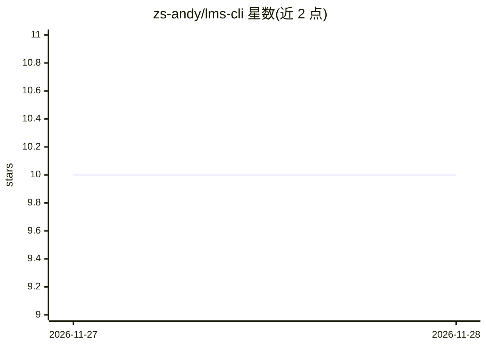

# zs-andy/lms-cli

⭐ 10 · TypeScript · MIT · 推送 2026-11-26 · [GitHub](https://github.com/zs-andy/lms-cli) · 个人维护 · 中文 README

**面向学生与 AI agent 的多平台 LMS 终端查询与只读 MCP 服务器**

终端 CLI 与只读 MCP 服务器，统一查询 Canvas、Blackboard、Moodle 三类学校 LMS 的课程、公告、作业、成绩、文件与日历。以 profile 隔离多校凭据，会话经 OS keychain 加密；工具明确只读，不提交作业、不发起考试。为 Codex 与 Claude Code 提供插件，并为任意 MCP 客户端提供 stdio 接入。安装脚本自包含 Node.js，支持 Homebrew/Scoop/Winget 清单，内置带校验与回滚的更新机制。后台静默重登录为默认关闭的可选功能，且无显示服务器的 headless Linux 不支持。

## 筛选速览

| 维度 | 判定 | 备注 |
|---|---|---|
| AI 角色 | `ai-ecosystem` | LLM/agent 周边工具 |
| 许可风险 | `permissive` | MIT |
| 部署形态 | `None` |  |
| 模型依赖 | — | README 未给出锁定关系 |
| 硬件要求 | — | 无带数字的原话,不猜 |
| 安装摩擦 | `low` | 无编译、无系统依赖或容器化 |
| 成熟度 | — | 结构信号不足 |

## 能力要点

- 一个终端接口查询 Canvas/Blackboard/Moodle，多校 profile 隔离凭据与缓存
- 只读 MCP 服务器：显式工具白名单与 JSON Schema 校验，不改写 LMS 数据
- 为 Codex 与 Claude Code 提供插件，另支持任意 MCP 客户端 stdio 接入
- SHA-256 校验的独立发行包与支持回滚的自更新；本地 todo 可导出 .ics 日历

## 适用场景

- 在终端查课程、截止日期、成绩并下载课件
- 让 Codex/Claude Code 等 agent 只读访问学校 LMS 数据
- 跟踪公告中的日程变动并把待办导出为日历

## 场景标签

 · 领域:教育/LMS 工具

## 证据(README 行号)

> L5: **Multi-school Canvas, Blackboard & Moodle CLI and read-only MCP server for Codex, Claude Code, and terminal workflo
> L22: - **Agent-ready via MCP**: First-class plugins for **Codex** (`plugins/lms-cli/`) and **Claude Code** (`plugins/lms
> L23: - **Strictly read-only by design**: Explicit tool allowlist and JSON Schema validation — never submits assignments,

## 星数曲线

2026-11-27 10 → 2026-11-28 10（+0）

---
*卡片 v1 · prompt 1.4 · 生成 2026-11-27 · 置信度 high · 依据 README sha `fcd035b97c47` · [字段定义](../../DATASET.md)*
