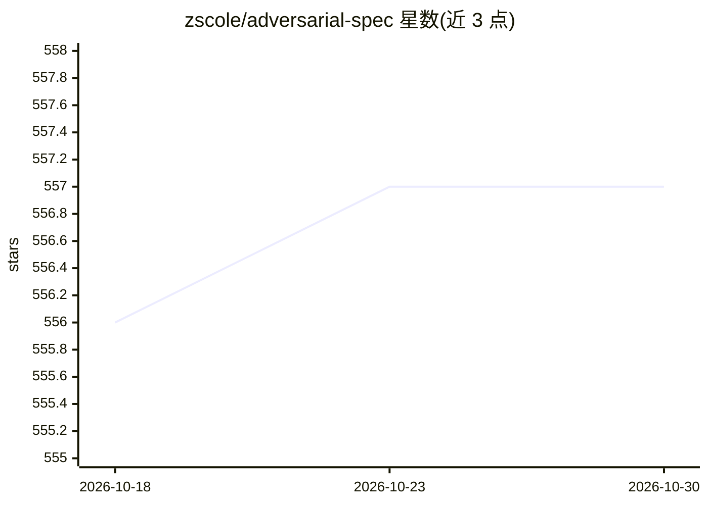

# zscole/adversarial-spec

⭐ 557 · Python · MIT · 推送 2026-01-22 · [GitHub](https://github.com/zscole/adversarial-spec) · 个人维护

**Claude Code 插件：多模型对抗辩论迭代完善产品规格文档**

面向 Claude Code 用户的规格文档生成插件：由 Claude 起草 PRD 或技术规格，随后将文档发给多个对手模型（GPT、Gemini、Grok 等）并行批评，Claude 同时作为参与者提供独立批评并综合反馈修订，循环直至所有模型与 Claude 达成一致；包含早同意验证、用户审阅期、多轮审查、批评焦点模式、模型人设、上下文注入与会话持久化等功能。模型调用经由 litellm，支持 OpenAI/Anthropic/Google/xAI/Mistral/Groq/OpenRouter/Deepseek/Zhipu 等提供商，以及 AWS Bedrock 路由、Codex CLI、Gemini CLI 和 OpenAI 兼容端点（含本地 Ollama/vLLM）。

## 筛选速览

| 维度 | 判定 | 备注 |
|---|---|---|
| AI 角色 | `ai-native` | 本体是模型或模型工具 |
| 许可风险 | `permissive` | MIT |
| 部署形态 | `library` | 以包/库形式分发 |
| 模型依赖 | local-ok | 支持本地模型 |
| 硬件要求 | — | 无带数字的原话,不猜 |
| 安装摩擦 | `low` | 无编译、无系统依赖或容器化 |
| 成熟度 | — | 结构信号不足 |

## 能力要点

- Claude 起草 + 多对手模型并行批评 + Claude 独立参与的辩论循环直至共识
- 支持 10+ 模型提供商及 AWS Bedrock 全量路由模式
- 批评焦点模式（security/scalability/performance 等）与自定义模型人设
- 会话持久化、自动检查点与恢复机制

## 适用场景

- 让多个 LLM 互相审查我的 PRD 或技术规格以发现遗漏
- 在安全或性能等特定关注点上做定向多轮审查
- 从产品想法出发通过访谈模式生成完整规格文档

## 场景标签

`AI 写作` `多智能体` · 领域:Agent 开发

## 证据(README 行号)

> L3: A Claude Code plugin that iteratively refines product specifications through multi-model debate until consensus is r
> L30: 4. Document is sent to opponent models (GPT, Gemini, Grok, etc.) for parallel critique
> L33: 7. Loop continues until ALL models AND Claude agree

## 星数曲线

2026-10-18 556 → 2026-10-30 557（+1）

---
*卡片 v1 · prompt 1.4 · 生成 2026-10-22 · 置信度 mid · 依据 README sha `da5f6a7e162a` · [字段定义](../../DATASET.md)*
