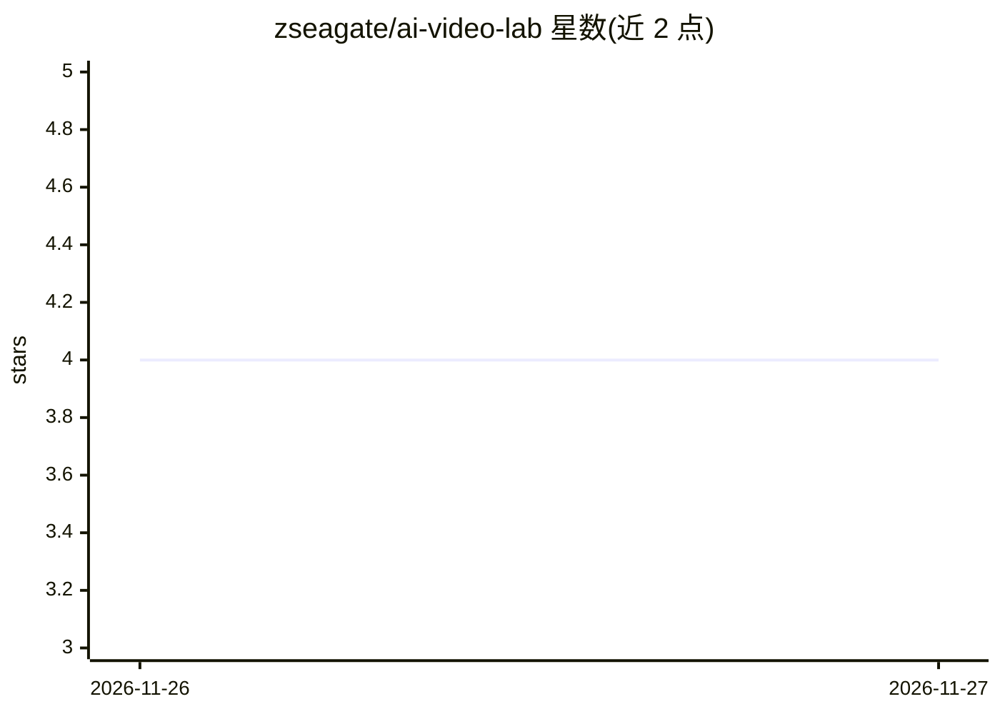

# zseagate/ai-video-lab

⭐ 4 · Python · MIT · 推送 2026-11-10 · [GitHub](https://github.com/zseagate/ai-video-lab) · 个人维护 · 中文 README

**本地 AI 视频生产流水线工具包：剧本到合成质检六阶段**

仓库由两部分构成：文档/模板部分提供四层拆解法、拉片表、资产护照、成本模型等可复用模板；lab/ 部分是 Python + FFmpeg 实现的六阶段练习平台（init→import-script→storyboard→audio→composite→qc），每步可单独重跑。默认路径零推理、低配可用（FFmpeg 关键帧动效 + SAPI 念白），可插拔切换到实拍素材、本地 Wan 或云端 Seedance；自带管理台（仅监听 127.0.0.1）与离线环境自检命令。面向创作者、企业市场、教师与小团队。

## 筛选速览

| 维度 | 判定 | 备注 |
|---|---|---|
| AI 角色 | `ai-native` | 本体是模型或模型工具 |
| 许可风险 | `permissive` | MIT |
| 部署形态 | `None` |  |
| 模型依赖 | local-ok | 支持本地模型 |
| 硬件要求 | — | 无带数字的原话,不猜 |
| 安装摩擦 | `medium` | 含编译或系统依赖之一 |
| 成熟度 | — | 结构信号不足 |

## 能力要点

- 六阶段流水线（剧本→分镜→声音→合成→QC），每步可单独重跑
- 视频引擎可插拔：FFmpeg 关键帧动效 / 实拍素材 / 本地 Wan / 云端 Seedance / 占位
- 本地小 LLM（llama-cpp-python + Qwen2.5）增强提示词，无模型回退规则引擎
- run.py doctor 离线自检环境，不发布网络请求

## 适用场景

- 低成本练手 AI 视频生产全流程
- 有实拍/授权素材时叠加 AI 风格层出片
- 教学或文章中做匿名化视频拆解分析
- 企业/自媒体按成本模型预算化生产短片

## 场景标签

`提示工程` `视频生成` · 领域:Agent 开发

## 证据(README 行号)

> L3: > 仓库定位：`ai-video-lab` —— 一套可复现、零成本起步的**本地 AI 视频制作实验室**（剧本 → 分镜 → 声音 → 合成 → QC），配套开源方法论、技术栈参考与可复用模板。
> L74: `lab/` 是一套可复现的**本地练习平台**，把「剧本 → 分镜 → 声音 → 合成 → QC」串成六个阶段，默认走零成本、低配可用的路径，任何一步都可单独重跑：
> L92: > 视频引擎可插拔：`kenburns`（关键帧动效，纯 FFmpeg，无需模型）→ `footage`（实拍）→ `seedance`（云端）→ `wan_local`（本地草稿）→ `placeholder`。低配机器推荐 `

## 星数曲线

2026-11-26 4 → 2026-11-27 4（+0）

---
*卡片 v1 · prompt 1.4 · 生成 2026-11-26 · 置信度 high · 依据 README sha `de4371577b37` · [字段定义](../../DATASET.md)*
