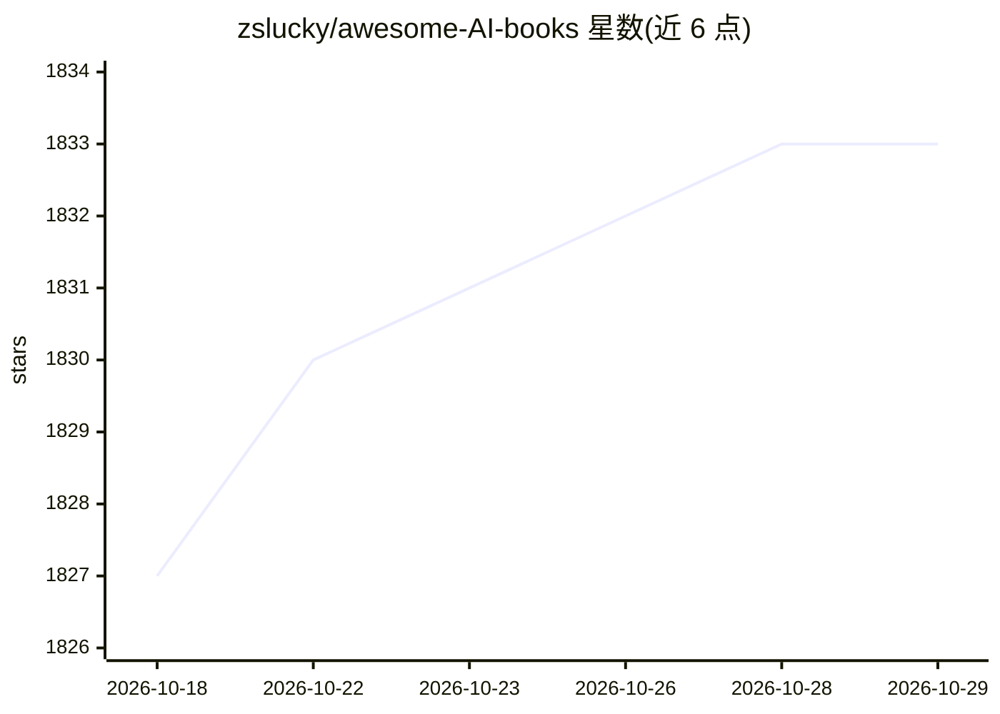

# zslucky/awesome-AI-books

⭐ 1,833 · Jupyter Notebook · MIT · 推送 2026-07-07 · [GitHub](https://github.com/zslucky/awesome-AI-books) · 个人维护 · 中文 README

**AI 学习书籍与 PDF 清单：按领域分类并附训练环境**

AI 相关学习资源的聚合清单：收录数学、机器学习、数据挖掘、深度学习、量子计算等类别的书籍（含中文译本与英文原版，商业书籍有标注），因 GitHub 大文件限制 PDF 存放于 Yandex.Disk；另收录研究机构入口、强化学习训练环境（Gym、PySC2 等）以及各类 ML 库与论文链接。声明仅供学习、不得商用，通过 issue/PR 接收贡献。

## 筛选速览

| 维度 | 判定 | 备注 |
|---|---|---|
| AI 角色 | `ai-knowledge` | 知识聚合/清单类 |
| 许可风险 | `permissive` | MIT |
| 部署形态 | `None` |  |
| 模型依赖 | — | README 未给出锁定关系 |
| 硬件要求 | — | 无带数字的原话,不猜 |
| 安装摩擦 | `low` | 无编译、无系统依赖或容器化 |
| 成熟度 | — | 结构信号不足 |

## 能力要点

- 按数学/数据挖掘/深度学习/量子 AI 等 10 余类别组织书籍条目
- PDF 存放于 Yandex.Disk，商业书籍单独标注 COMMERCIAL
- 收录 20 余个强化学习训练环境（Gym、malmo、PySC2 等）
- 覆盖中英文书籍，中文多为经典教材译本（西瓜书、统计学习方法等）

## 适用场景

- 系统查找某门 AI 课程对应的教材与中文译本
- 为强化学习实验寻找可用训练环境
- 按类别浏览了解某方向（如 AutoML、量子 AI）的书籍与资源

## 场景标签

`精选清单` · 领域:学习与行业

## 证据(README 行号)

> L1: # Awesome AI books
> L15: ## Content
> L73: ## Books

## 星数曲线

2026-10-18 1,827 → 2026-10-29 1,833（+6）

---
*卡片 v1 · prompt 1.4 · 生成 2026-10-21 · 置信度 high · 依据 README sha `c91164245606` · [字段定义](../../DATASET.md)*
