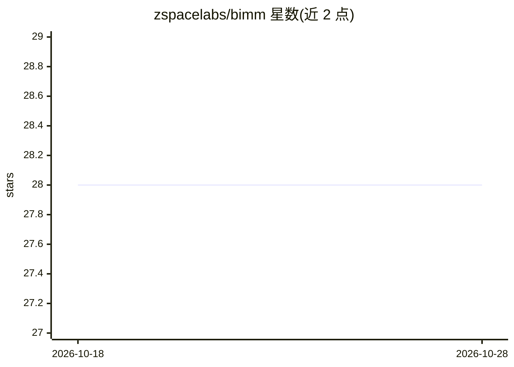

# zspacelabs/bimm

⭐ 28 · Rust · MIT · 推送 2026-05-21 · [GitHub](https://github.com/zspacelabs/bimm) · 组织维护

**Rust 烧伤(burn)框架图像模型库，提供预训练模型与数据管线**

基于 Burn 深度学习框架的 Rust 图像模型库，功能定位受 Python timm 包启发。主 crate bimm 提供可复用层（激活、卷积归一化块、dropout、patch embedding）、完整模型族（ResNet、Swin、Swin-V2）及磁盘权重缓存，示例展示预训练模型构建与 ResNet 微调；配套 crate bimm-contracts 提供张量形状契约的静态定义与检查（已迁至独立仓库），bimm-firehose 提供 SQL 风格的数据加载与增强管线框架。README 声明部分 crate 仍在早期开发中。

## 筛选速览

| 维度 | 判定 | 备注 |
|---|---|---|
| AI 角色 | `ai-native` | 本体是模型或模型工具 |
| 许可风险 | `permissive` | MIT |
| 部署形态 | `library` | 以包/库形式分发 |
| 模型依赖 | — | README 未给出锁定关系 |
| 硬件要求 | — | 无带数字的原话,不猜 |
| 安装摩擦 | `low` | 无编译、无系统依赖或容器化 |
| 成熟度 | `idea` | |

## 能力要点

- 提供 ResNet / Swin / Swin-V2 完整模型族与预训练权重加载
- 可复用神经网络层：激活、Conv2d+BatchNorm2d、DropBlock/DropPath、PatchEmbed
- bimm-contracts：张量形状契约的静态定义与强制检查
- bimm-firehose：SQL 风格表+操作的模块化数据管线框架

## 适用场景

- 在 Rust 中加载预训练图像模型做推理或微调
- 为 Burn 框架项目复用图像模型与网络层组件
- 构建带形状静态检查的张量运算代码
- 搭建模块化图像数据加载与增强管线

## 场景标签

 · 领域:计算机视觉/深度学习库

## 证据(README 行号)

> L7: This is a repository for burn image models; inspired by the Python `timm` package.
> L39: * bimm::models - complete model families.

## 星数曲线

2026-10-18 28 → 2026-10-28 28（+0）

---
*卡片 v1 · prompt 1.4 · 生成 2026-10-26 · 置信度 high · 依据 README sha `9869e8ccac16` · [字段定义](../../DATASET.md)*
