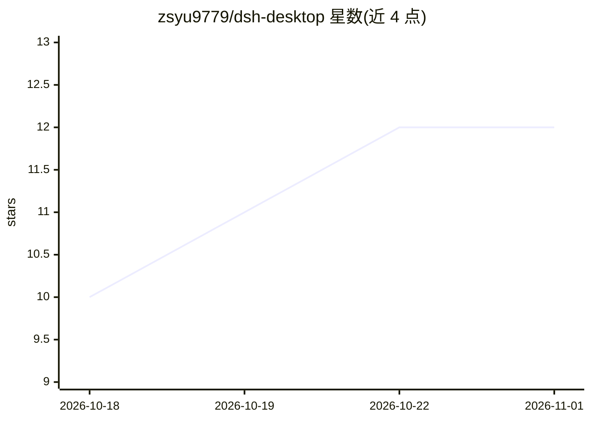

# zsyu9779/dsh-desktop

⭐ 12 · Go · MIT · 推送 2026-10-20 · [GitHub](https://github.com/zsyu9779/dsh-desktop) · [官网](https://zsyu9779.github.io/dsh-desktop/) · 个人维护 · 中文 README

**DeepSeek Harness 的非官方跨平台桌面壳（Wails）**

用 Go 和 Wails 将官方 @deepseek-ai/dsh Web UI 封装为 macOS、Windows、Linux 原生窗口的社区桌面客户端。不重新实现 Harness，而是通过 npm exec 拉取并运行固定版本（0.2.1-rc.2）的上游包，提供自动启动、进程树清理、日志查看、端口选择、局域网手机扫码远程及插件预装管理；对话、模型等能力均由上游提供。运行需预装 Node.js 22.19+ 或 24.2+，非完全离线安装包。面向希望以原生窗口使用 DSH 的桌面用户。

## 筛选速览

| 维度 | 判定 | 备注 |
|---|---|---|
| AI 角色 | `ai-ecosystem` | LLM/agent 周边工具 |
| 许可风险 | `permissive` | MIT |
| 部署形态 | `desktop` | 安装包/桌面程序 |
| 模型依赖 | — | README 未给出锁定关系 |
| 硬件要求 | — | 无带数字的原话,不猜 |
| 安装摩擦 | `low` | 无编译、无系统依赖或容器化 |
| 成熟度 | `idea` | |

## 能力要点

- Wails 原生窗口封装 DSH Web UI，支持三平台发布包
- 自动启动固定版本 @deepseek-ai/dsh 并在退出时清理完整进程树
- 局域网手机扫码远程控制（一次性配对码、自签名 HTTPS）
- 预装 5 个常用 DSH 插件并做版本跟踪与升级

## 适用场景

- 在原生桌面窗口中使用 DeepSeek Harness，减少命令行操作
- 自动管理 DSH 后台进程与日志排查
- 同一 Wi-Fi 下用手机浏览器操控电脑上的 DSH

## 场景标签

`编码 Agent` · 领域:编码与开发

## 证据(README 行号)

> L7: **Unofficial cross-platform desktop app for DeepSeek Harness — a native Wails shell for the DSH Web UI on macOS, Win
> L40: DeepSeek Harness 的对话、模型、插件、会话和设置能力均由上游项目提供。本项目只负责桌面容器、启动流程和子进程生命周期。

## 星数曲线

2026-10-18 10 → 2026-11-01 12（+2）

---
*卡片 v1 · prompt 1.4 · 生成 2026-10-31 · 置信度 high · 依据 README sha `40d8ed90dfb7` · [字段定义](../../DATASET.md)*
