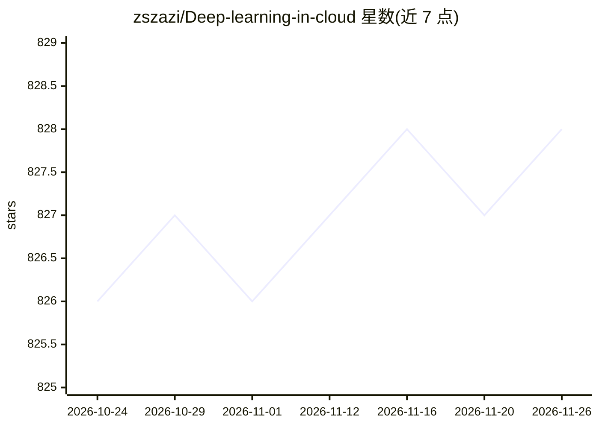

# zszazi/Deep-learning-in-cloud

⭐ 828 · MIT · 推送 2026-11-16 · [GitHub](https://github.com/zszazi/Deep-learning-in-cloud) · 个人维护

**深度学习云 GPU 服务商与 MLOps 平台的策展清单**

一份面向需要远程算力的深度学习从业者的资源清单：按三个表格组织——GPU 云服务商（含定价与免费额度说明）、可部署 Web 应用的托管平台、MLOps 平台；另设学生/研究者免费额度与资助计划汇总板块。条目附官网链接、计费方式与免费试用信息，末尾附注意事项（如 Colab/Kaggle 会话时长限制），以 GitHub 清单形式维护，无安装或运行步骤。

## 筛选速览

| 维度 | 判定 | 备注 |
|---|---|---|
| AI 角色 | `ai-knowledge` | 知识聚合/清单类 |
| 许可风险 | `permissive` | MIT |
| 部署形态 | `None` |  |
| 模型依赖 | — | README 未给出锁定关系 |
| 硬件要求 | — | 无带数字的原话,不猜 |
| 安装摩擦 | `low` | 无编译、无系统依赖或容器化 |
| 成熟度 | — | 结构信号不足 |

## 能力要点

- 收录数十家 GPU 云服务商的定价与免费额度信息
- MLOps 平台专表覆盖机器学习全生命周期工具
- 汇总学生/研究者可申请的免费 GPU 时长与资助计划
- 标注 Google Colab 与 Kaggle Kernels 等免费选项

## 适用场景

- 笔记本跑不动模型时寻找合适的云 GPU 训练资源
- 为模型部署选择托管平台
- 学生或研究者寻找免费算力与厂商资助计划
- 选型 MLOps 平台管理机器学习流程

## 场景标签

`精选清单` · 领域:学习与行业

## 证据(README 行号)

> L1: # ☁️☁️Deep-learning-in-cloud☁️☁️
> L10: |Cloud vendor|Website|Pricing|Free Trial / Free Credits|
> L77: # MLOps Platforms

## 星数曲线

2026-10-24 826 → 2026-11-26 828（+2）

---
*卡片 v1 · prompt 1.4 · 生成 2026-11-24 · 置信度 high · 依据 README sha `09e430f33028` · [字段定义](../../DATASET.md)*
