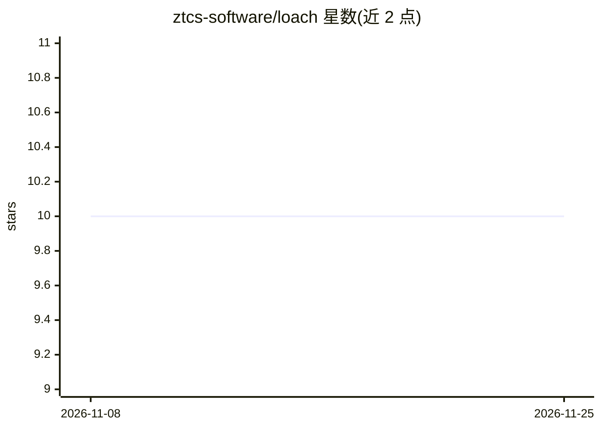

# ztcs-software/loach

⭐ 10 · TypeScript · MIT · 推送 2026-11-20 · [GitHub](https://github.com/ztcs-software/loach) · [官网](https://loach.dev) · 组织维护

**面向桌面用户的本地优先 AI 工作区，管理本地与远程 LLM 对话**

基于 Tauri 2 + React 19 的原生桌面 AI 工作区，支持连接本地 Ollama 服务器及任意 OpenAI 兼容端点。功能覆盖模型管理（拉取/复制/删除）、Spaces 项目分组、库与数据集附件检索（关键词与可选嵌入模型）、全局记忆、MCP 服务器注册与工具调用审批、本地工具集、代码画布与附件预览。无遥测，API key 存于系统凭据管理器。三平台提供预构建安装包，macOS 版仅限 Apple Silicon。

## 筛选速览

| 维度 | 判定 | 备注 |
|---|---|---|
| AI 角色 | `ai-ecosystem` | LLM/agent 周边工具 |
| 许可风险 | `permissive` | MIT |
| 部署形态 | `desktop` | 安装包/桌面程序 |
| 模型依赖 | local-ok | 支持本地模型 |
| 硬件要求 | — | 无带数字的原话,不猜 |
| 安装摩擦 | `medium` | 含编译或系统依赖之一 |
| 成熟度 | — | 结构信号不足 |

## 能力要点

- 同时连接 Ollama 本地模型与任意 OpenAI 兼容端点（llama.cpp、LM Studio、vLLM、LiteLLM）
- MCP 支持：Streamable HTTP 或本地 stdio 进程，工具调用逐次审批
- Library 数据集检索增强，回复标注引用来源，支持关键词与嵌入两种检索
- 无遥测，可选 API key 存于 OS 凭据管理器，支持私密聊天不落盘

## 适用场景

- 在桌面端统一管理本地模型的对话与项目资料
- 接入自建的 OpenAI 兼容推理端点进行日常对话
- 让模型在沙盒文件夹中读写项目文件并调用 MCP 工具

## 场景标签

`RAG` `AI 助手` · 领域:对话与助手

## 证据(README 行号)

> L3: **A native, local-first AI workspace for desktops**
> L21: Loach is an all-in-one desktop AI workspace built around a single idea: talking to an LLM should feel effortless. S
> L65: - **MCP support** - register Model Context Protocol servers over Streamable HTTP or as local stdio processes (`npx`

## 星数曲线

2026-11-08 10 → 2026-11-25 10（+0）

---
*卡片 v1 · prompt 1.4 · 生成 2026-11-19 · 置信度 high · 依据 README sha `325ac10678a0` · [字段定义](../../DATASET.md)*
