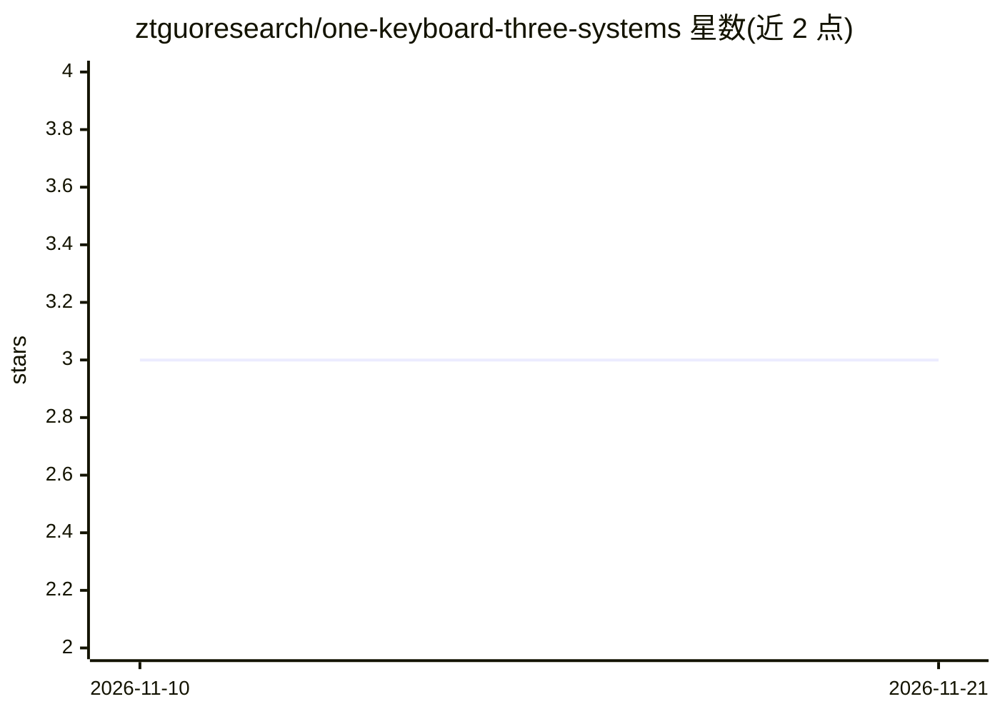

# ztguoresearch/one-keyboard-three-systems

⭐ 3 · HTML · MIT · 推送 2026-11-09 · [GitHub](https://github.com/ztguoresearch/one-keyboard-three-systems) · [官网](https://ztguoresearch.github.io/one-keyboard-three-systems/) · 组织维护 · 中文 README

**用 Deskflow 在三系统间共享键鼠的实战教程与排障笔记**

一份关于跨 Windows/Linux/macOS 共享键鼠的实战笔记仓库，基于开源软件 Deskflow 记录完整配置流程：网线直连静态 IP、Server/Client 架构、TLS 与防火墙只放行 24800 端口对端 IP、Samba 文件共享与 Windows 映射 Z 盘。附错误信息对照表、可勾选复现清单、PowerShell 与 shell 配置脚本，以及一篇 AI 辅助排障流程复盘。macOS 部分依据官方文档整理，作者标注未实机验证。适合能在多台电脑间接受一次性命令行配置的用户。

## 筛选速览

| 维度 | 判定 | 备注 |
|---|---|---|
| AI 角色 | `ai-knowledge` | 知识聚合/清单类 |
| 许可风险 | `permissive` | MIT |
| 部署形态 | `desktop` | 安装包/桌面程序 |
| 模型依赖 | — | README 未给出锁定关系 |
| 硬件要求 | — | 无带数字的原话,不猜 |
| 安装摩擦 | `low` | 无编译、无系统依赖或容器化 |
| 成熟度 | — | 结构信号不足 |

## 能力要点

- 覆盖直连组网、防火墙、TLS、剪贴板的完整复现步骤并附日志证据
- 提供防火墙、静态 IP、Samba 配置的可执行脚本
- 错误信息对照表与可打印的复现清单
- 记录 AI 辅助排障的工作流复盘

## 适用场景

- 一套键鼠控制 Windows/Linux/macOS 多台电脑
- 不想购买 KVM 切换器或对拷线的双机办公环境
- 按清单复现网线直连的 Deskflow 部署
- 参考 AI 辅助排障的复盘思路处理配置问题

## 场景标签

`教程课程` · 领域:学习与行业

## 证据(README 行号)

> L17: 这不是 Deskflow 的官方文档。它是一份**踩过坑、能复现、带日志证据**的实战笔记：
> L24: - AI 在排障中哪些地方真的有用，哪些地方只会添乱。
> L142: |`docs/09-ai-workflow.md`|怎样让 AI 做排障副驾，而不是让它瞎猜|

## 星数曲线

2026-11-10 3 → 2026-11-21 3（+0）

---
*卡片 v1 · prompt 1.4 · 生成 2026-11-21 · 置信度 high · 依据 README sha `a3461ed1937e` · [字段定义](../../DATASET.md)*
