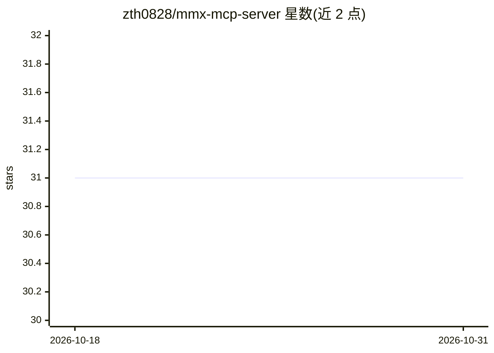

# zth0828/mmx-mcp-server

⭐ 31 · JavaScript · MIT · 推送 2026-07-25 · [GitHub](https://github.com/zth0828/mmx-mcp-server) · 个人维护 · 中文 README

**封装 mmx CLI 的 MiniMax 全模态 MCP Server**

基于 MiniMax 的 mmx CLI 封装而成的统一 MCP Server，向支持 MCP 的 AI CLI 工具暴露 9 个工具：网页搜索、图像理解、文本对话、图像/音乐/视频生成、语音合成 TTS 与配额查询。通过 npm 全局安装 mmx-cli 后克隆仓库构建，以 MCP 配置接入 Claude Code、OpenCode 等客户端；API Key 可经环境变量、命令行参数或 mmx CLI 本地登录三种方式注入，生成的媒体文件默认落当前工作目录，可经 MMX_OUTPUT_DIR 或 out 参数改路径。

## 筛选速览

| 维度 | 判定 | 备注 |
|---|---|---|
| AI 角色 | `ai-ecosystem` | LLM/agent 周边工具 |
| 许可风险 | `permissive` | MIT |
| 部署形态 | `library` | 以包/库形式分发 |
| 模型依赖 | — | README 未给出锁定关系 |
| 硬件要求 | — | 无带数字的原话,不猜 |
| 安装摩擦 | `low` | 无编译、无系统依赖或容器化 |
| 成熟度 | — | 结构信号不足 |

## 能力要点

- 提供 9 个 MCP 工具，覆盖搜索、图像理解、文生图、TTS、视频/音乐生成
- 三种 API Key 注入方式（env、命令行参数、mmx CLI 本地登录回退）
- 输出目录可经 MMX_OUTPUT_DIR 统一配置或按调用 out 参数指定

## 适用场景

- 在 Claude Code 等 MCP 客户端中调用 MiniMax 的多模态生成能力
- 用自然语言触发网页搜索、图像分析与语音合成
- 查看 MiniMax 账户配额

## 场景标签

`图像生成` `语音合成` `视频生成` · 领域:内容生成

## 证据(README 行号)

> L5: 一个统一的 MiniMax 全模态 MCP Server，基于 `mmx` CLI 封装，支持文本、搜索、图像理解、图像生成、语音合成、视频生成、音乐生成和配额查询。
> L13: 如果你使用的是 Claude Code、OpenCode 或其他支持 MCP 的 AI CLI 工具，直接把下面这段话丢给 AI：

## 星数曲线

2026-10-18 31 → 2026-10-31 31（+0）

---
*卡片 v1 · prompt 1.4 · 生成 2026-10-26 · 置信度 high · 依据 README sha `15c59a35e1b1` · [字段定义](../../DATASET.md)*
