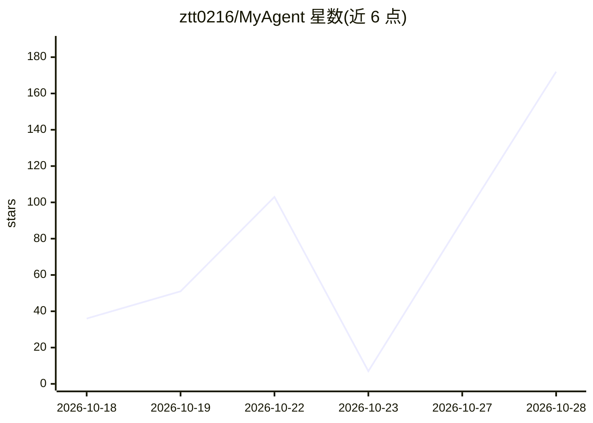

# ztt0216/MyAgent

⭐ 172 · Python · MIT · 推送 2026-10-16 · [GitHub](https://github.com/ztt0216/MyAgent) · 个人维护 · 中文 README

**从零实现的 Python 通用 Agent Runtime，含权限、MCP、Skills 自进化**

面向学习与二次开发的本地 Agent Runtime：以 Harness 为核心，统一编排模型推理、工具调用、权限控制、长期 Memory、子 Agent、MCP 外部工具与上下文压缩，形成完整 Agent Loop。支持 OpenAI-compatible 与 Anthropic-compatible 双协议，通过 .env 配置接入模型接口，以 Python 源码方式运行（REPL / 一次性任务 / Plan Mode / 会话恢复）。特色是 Skills 自进化：从用户反馈抽取可复用规则写入 SKILL.md，并生成 usage/provenance 审计产物。推荐环境为 Python 3.11+ 与 macOS/Linux。

## 筛选速览

| 维度 | 判定 | 备注 |
|---|---|---|
| AI 角色 | `ai-ecosystem` | LLM/agent 周边工具 |
| 许可风险 | `permissive` | MIT |
| 部署形态 | `library` | 以包/库形式分发 |
| 模型依赖 | — | README 未给出锁定关系 |
| 硬件要求 | — | 无带数字的原话,不猜 |
| 安装摩擦 | `low` | 无编译、无系统依赖或容器化 |
| 成熟度 | — | 结构信号不足 |

## 能力要点

- 完整 Agent Loop：请求、tool call 解析、权限检查、执行、回写、会话保存
- OpenAI / Anthropic 双协议接入，通过 .env 或 --api-base 配置
- 自研 stdio JSON-RPC MCP Client，包装外部 MCP Server 工具
- Skills 自进化：从用户反馈抽取规则并生成审计产物

## 适用场景

- 学习通用 Agent 的底层运行机制
- 作为个人 Agent 或项目分析助手的二次开发基础
- 沉淀可复用任务规则到项目级或用户级 Skill

## 场景标签

`Agent 框架` · 领域:Agent 开发

## 证据(README 行号)

> L5: MyAgent 是一个基于 Python 实现的通用 **Agent Runtime**。它不是简单的命令行聊天工具，而是一个可运行、可阅读、可扩展的本地 runtime：统一编排模型推理、工具调用、权限控制、长期记忆、Skills
> L7: 项目重点是 **Harness**。模型只负责推理和提出工具调用意图，真正的环境操作由 Runtime 统一做权限判断、工具执行、结果回写、上下文压缩和经验沉淀。它适合学习通用 Agent 的底层机制，也适合作为个人 Agent、项

## 星数曲线

2026-10-18 36 → 2026-10-28 172（+136）

---
*卡片 v1 · prompt 1.4 · 生成 2026-10-27 · 置信度 mid · 依据 README sha `09dc8c0192bd` · [字段定义](../../DATASET.md)*
