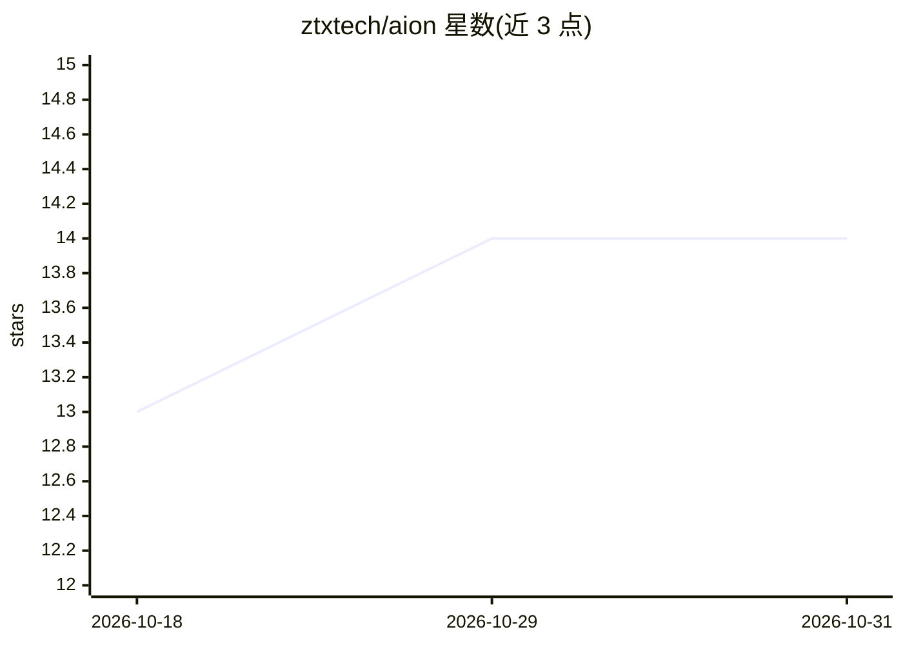

# ztxtech/aion

⭐ 14 · TypeScript · MIT · 推送 2026-10-13 · [GitHub](https://github.com/ztxtech/aion) · [官网](https://ztxtech.github.io/aion/) · 组织维护 · 中文 README

**基于 OpenCode 的时间序列多 Agent 任务执行框架**

AION 是编译为 OpenCode V2 插件的 TypeScript 时间序列 harness：以任务文件、工作区、验证接口三元组组织工作，通过主控 agent 调度需求分析、证据收集、实现、实验运行与分层评审等专职 agent，并用时间窗契约、证据绑定输出与停机门槛约束预测任务。安装分四步：先装 OpenCode，再以 curl 脚本装 AION CLI，在项目内 aion-ts init 写入插件与 TUI。随附医疗 ECG/脓毒症演示（明示未做临床验证，不得用于医疗决策）与本地 Kaggle 销量预测复刻示例。

## 筛选速览

| 维度 | 判定 | 备注 |
|---|---|---|
| AI 角色 | `ai-ecosystem` | LLM/agent 周边工具 |
| 许可风险 | `permissive` | MIT |
| 部署形态 | `None` |  |
| 模型依赖 | — | README 未给出锁定关系 |
| 硬件要求 | — | 无带数字的原话,不猜 |
| 安装摩擦 | `low` | 无编译、无系统依赖或容器化 |
| 成熟度 | — | 结构信号不足 |

## 能力要点

- 任务文件+工作区+验证接口三元组组织时间序列任务
- 多 agent 分派与分层评审停机门槛（ts-critic 等 7 类角色）
- 时间窗契约与证据绑定输出防止标签泄漏与无据结论
- aion-ts init 向项目内安装自包含 server 与 TUI 包

## 适用场景

- 在结构化验证下运行时间序列预测实验
- 以多 agent 流程完成从需求分析到评审交付的研究任务
- 在本地复刻 Kaggle 预测竞赛并即时评分迭代

## 场景标签

`多智能体` `Agent 框架` · 领域:Agent 开发

## 证据(README 行号)

> L12: **AION** is a time-series harness — an explicit control layer that connects task specification, runtime execution, 
> L53: AION is a compiled TypeScript plugin for OpenCode V2. The repository contains the source and release tooling; `aion

## 星数曲线

2026-10-18 13 → 2026-10-31 14（+1）

---
*卡片 v1 · prompt 1.4 · 生成 2026-10-31 · 置信度 high · 依据 README sha `7a1b8bcb9110` · [字段定义](../../DATASET.md)*
