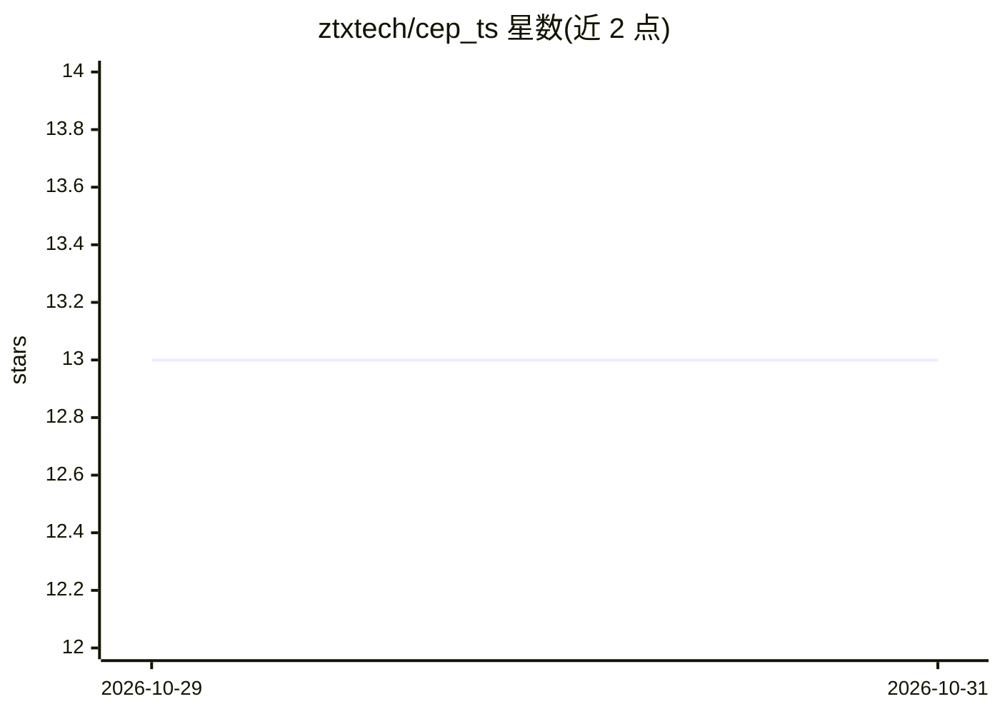

# ztxtech/cep_ts

⭐ 13 · Python · MIT · 推送 2026-10-27 · [GitHub](https://github.com/ztxtech/cep_ts) · [官网](https://ztxtech.github.io/cep_ts/) · 组织维护

**应对重复概念漂移的在线时间序列预测方法 CEP 官方 PyTorch 实现**

论文 "Continuous Evolution Pool: Taming Recurring Concept Drift in Online Time Series Forecasting" 的官方 PyTorch 代码实现。CEP 是一种池化机制：为不同概念存储多个预测器，新样本到达时选择池中最近的预测器进行预测并从邻居样本学习；邻居样本不足时判定新概念出现并新增模型，同时带淘汰机制过滤过时知识与噪声数据。提供数据解压、配置文件运行与复现论文主实验/消融/基线对比/参数敏感性的脚本，代码基于 FSNet、OneNet 与 Time Series Library 构建，MIT 许可。

## 筛选速览

| 维度 | 判定 | 备注 |
|---|---|---|
| AI 角色 | `ai-native` | 本体是模型或模型工具 |
| 许可风险 | `permissive` | MIT |
| 部署形态 | `library` | 以包/库形式分发 |
| 模型依赖 | — | README 未给出锁定关系 |
| 硬件要求 | — | 无带数字的原话,不猜 |
| 安装摩擦 | `low` | 无编译、无系统依赖或容器化 |
| 成熟度 | — | 结构信号不足 |

## 能力要点

- 按概念存储多个预测器并选择最近预测器做预测的池化机制
- 邻居样本不足时自动新增模型，附淘汰机制过滤过时知识
- 提供复现论文主实验、消融、基线对比与参数敏感性的脚本

## 适用场景

- 复现论文中的在线时间序列预测实验
- 在存在重复概念漂移的数据集上运行 CEP 预测
- 对比 CEP 与在线预测基线方法的结果

## 场景标签

 · 领域:机器学习/时间序列预测

## 证据(README 行号)

> L26: To address these limitations, we propose the Continuous Evolution Pool (CEP), a novel pooling mechanism designed to
> L74: 1. Run the main script:

## 星数曲线

2026-10-29 13 → 2026-10-31 13（+0）

---
*卡片 v1 · prompt 1.4 · 生成 2026-10-31 · 置信度 high · 依据 README sha `d6b34caf5a99` · [字段定义](../../DATASET.md)*
