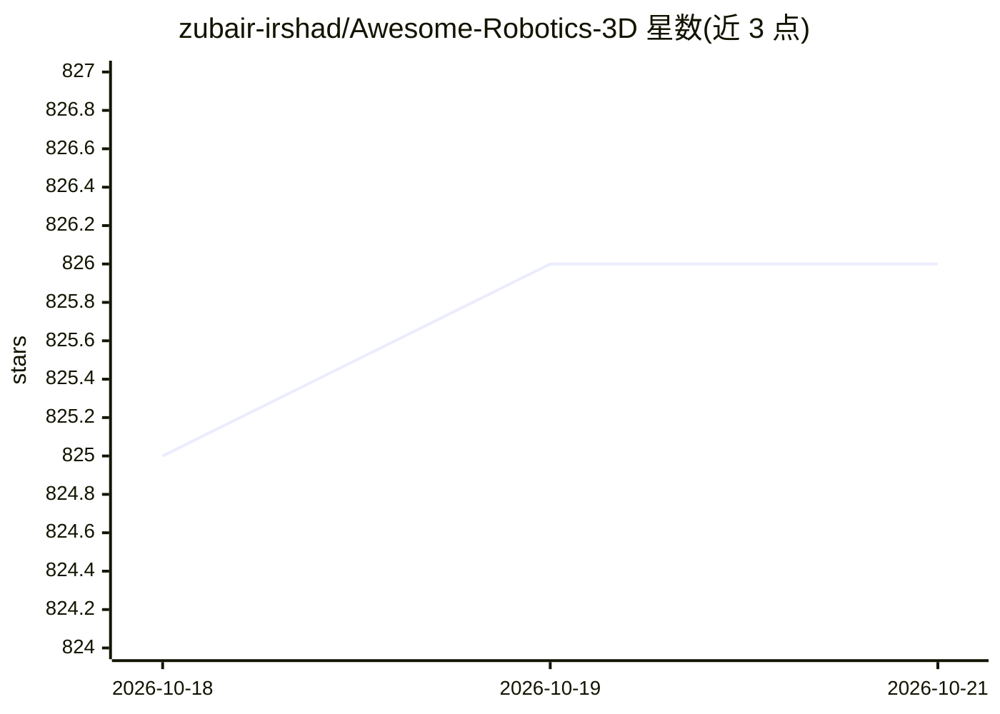

# zubair-irshad/Awesome-Robotics-3D

⭐ 825 · 推送 2025-12-17 · [GitHub](https://github.com/zubair-irshad/Awesome-Robotics-3D) · 个人维护

**机器人领域 3D 视觉论文策展清单（大模型时代）**

由 Zubair Irshad 个人维护的 awesome 类论文清单，收录大模型（LLM/VLM）时代与机器人相关的 3D 视觉论文，按 Policy Learning、Pretraining、VLM and LLM、Representation、Simulations/Datasets/Benchmarks 五大类组织。每条目给出论文名称、发表会议/期刊与年份，并链接 Paper、Webpage、Code 等资源；另列出若干综述论文。条目通过 PR 与邮件接收增补，无代码或安装内容，属纯知识聚合仓库。

## 筛选速览

| 维度 | 判定 | 备注 |
|---|---|---|
| AI 角色 | `ai-knowledge` | 知识聚合/清单类 |
| 许可风险 | `none` | — |
| 部署形态 | `None` |  |
| 模型依赖 | — | README 未给出锁定关系 |
| 硬件要求 | — | 无带数字的原话,不猜 |
| 安装摩擦 | `low` | 无编译、无系统依赖或容器化 |
| 成熟度 | — | 结构信号不足 |

## 能力要点

- 覆盖 Policy Learning、VLM/LLM、Representation 等 5 个类别的机器人 3D 视觉论文
- 每条目附论文链接，多数附 Webpage 与 Code 链接
- 收录 NeRF、Gaussian Splatting、点云等多种 3D 表示方向的论文
- 另列 4 篇相关综述论文

## 适用场景

- 查找机器人操作与导航相关的 3D 视觉论文及代码
- 跟踪 LLM/VLM 与 3D 视觉结合的研究进展
- 了解机器人领域基准与数据集工作

## 场景标签

 · 领域:机器人/3D 视觉研究

## 证据(README 行号)

> L5: This repo contains a curated list of **3D Vision papers relating to Robotics domain in the era of large models i.e. 
> L23: ## 🏠 Overview

## 星数曲线

2026-10-18 825 → 2026-10-21 826（+1）

---
*卡片 v1 · prompt 1.4 · 生成 2026-10-22 · 置信度 high · 依据 README sha `f48366a17995` · [字段定义](../../DATASET.md)*
