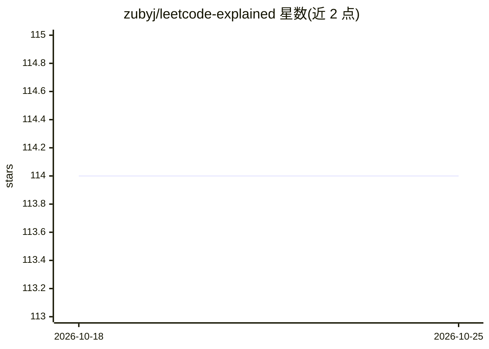

# zubyj/leetcode-explained

⭐ 114 · TypeScript · MIT · 推送 2026-09-08 · [GitHub](https://github.com/zubyj/leetcode-explained) · [官网](https://leetcodeapp.com) · 个人维护

**浏览器扩展：为 LeetCode 题目添加 AI 解答与视频讲解**

Chrome/Firefox 浏览器扩展，在 LeetCode 题目页注入功能：Python/Java/C++/JavaScript 代码解答、YouTube 视频讲解 Top5、公司标签、题目难度评分与面试模式。AI 部分由 Amazon Nova Micro v1 驱动，无需 API key，可基于题目描述生成优化解法并分析代码时间/空间复杂度。数据全部本地存储，不收集个人数据。以源码方式开发者模式安装（git clone + npm install + tsc），同时提供商店下载。

## 筛选速览

| 维度 | 判定 | 备注 |
|---|---|---|
| AI 角色 | `ai-enhanced` | 去掉 AI 部分产品仍成立 |
| 许可风险 | `permissive` | MIT |
| 部署形态 | `library` | 以包/库形式分发 |
| 模型依赖 | — | README 未给出锁定关系 |
| 硬件要求 | — | 无带数字的原话,不猜 |
| 安装摩擦 | `low` | 无编译、无系统依赖或容器化 |
| 成熟度 | — | 结构信号不足 |

## 能力要点

- AI 生成优化解法与时间/空间复杂度分析，无需 API key
- 四种语言的现成代码解答与 Top5 YouTube 视频讲解
- 公司标签、题目 Elo 评分（覆盖约 25% 题目）与面试模式
- 数据本地存储，不收集个人数据

## 适用场景

- 刷 LeetCode 时直接查看多语言解答与视频讲解
- 让 AI 分析自己代码的复杂度或生成优化解法
- 通过公司标签与难度评分筛选和评估题目

## 场景标签

`代码生成` · 领域:编码与开发

## 证据(README 行号)

> L8: **Enhance Leetcode with AI-generated solutions, video explanations, and smart features.**
> L25: - **AI Assistant**

## 星数曲线

2026-10-18 114 → 2026-10-25 114（+0）

---
*卡片 v1 · prompt 1.4 · 生成 2026-10-23 · 置信度 high · 依据 README sha `493ca6366cb9` · [字段定义](../../DATASET.md)*
