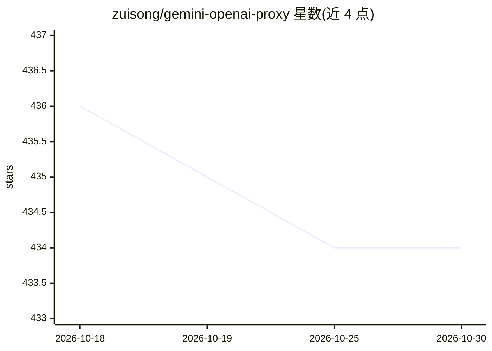

# zuisong/gemini-openai-proxy

⭐ 434 · TypeScript · MIT · 推送 2026-04-02 · [GitHub](https://github.com/zuisong/gemini-openai-proxy) · [官网](https://gemini-openai-proxy.zuisong.workers.dev) · 个人维护

**把 OpenAI API 协议调用转换为 Google Gemini 协议的代理**

一种代理软件：将 OpenAI 协议的 chat、embedding 调用转换为 Google Gemini Pro 协议，使基于 OpenAI API 开发的软件无需修改即可调用 Gemini 模型；内置模型名映射表（如 gpt-4→gemini-1.5-pro-latest），并通过 supertonic 实现 tts-1 语音合成。支持流式与完整两种 chat 模式。可部署于 Cloudflare Workers、Deno Deploy、Vercel，也可用 deno/node/bun 本地运行或以 Docker 镜像运行。使用时需自备 Gemini API key，TTS 需另行部署 supertonic 端点。

## 筛选速览

| 维度 | 判定 | 备注 |
|---|---|---|
| AI 角色 | `ai-ecosystem` | LLM/agent 周边工具 |
| 许可风险 | `permissive` | MIT |
| 部署形态 | `self-host` | docker 或自建部署 |
| 模型依赖 | — | README 未给出锁定关系 |
| 硬件要求 | — | 无带数字的原话,不猜 |
| 安装摩擦 | `low` | 无编译、无系统依赖或容器化 |
| 成熟度 | — | 结构信号不足 |

## 能力要点

- OpenAI 协议 chat/embedding 调用透明转换为 Gemini 协议
- 请求模型名到 Gemini 模型的映射表
- 通过 supertonic 实现 tts-1 模型
- 支持 Cloudflare Workers/Deno Deploy/Vercel 无服务器部署及 deno/node/bun/Docker 运行

## 适用场景

- 已按 OpenAI API 开发的软件不改代码接入 Gemini 模型
- 在无服务器平台部署一个 OpenAI 兼容端点
- 以低成本方式使用 Gemini 完成 chat 与 embedding 调用

## 场景标签

`模型网关` · 领域:Agent 开发

## 证据(README 行号)

> L10: Gemini-OpenAI-Proxy is a proxy software. It is designed to convert OpenAI API
> L11: protocol calls into Google Gemini Pro protocol, so that software using OpenAI
> L12: protocol can use Gemini Pro model without perception.

## 星数曲线

2026-10-18 436 → 2026-10-30 434（-2）

---
*卡片 v1 · prompt 1.4 · 生成 2026-10-21 · 置信度 high · 依据 README sha `c77583b70812` · [字段定义](../../DATASET.md)*
