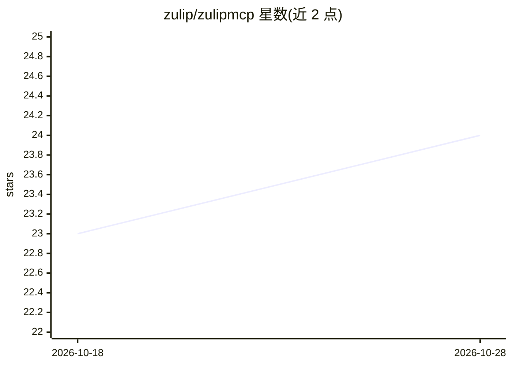

# zulip/zulipmcp

⭐ 24 · Python · Apache-2.0 · 推送 2026-08-03 · [GitHub](https://github.com/zulip/zulipmcp) · [官网](https://windbornesystems.com/) · 组织维护

**把 AI agent 以 @提及机器人形式接入 Zulip 的 MCP 服务器**

以 Python 包形式提供，包含四个入口：Zulip 工具的 MCP 服务器（stdio/SSE）、监听 @提及并按 (stream, topic) 生成无头 agent 会话的 listener、单次直接启动编码会话的 launcher，以及可导入的 Python 库。后端支持 Claude Code（默认）、Codex 与 OpenCode CLI；另有 Hermes 原生网关适配。核心机制包括长轮询 listen 工具、reply 前补抓漏读消息、表情符号终止会话、/nobots 过滤与出站 markdown 归一化；listener 刻意不设并发上限与工作区隔离。需要 Python 3.10+、.zuliprc 凭据及已安装的后端 CLI。

## 筛选速览

| 维度 | 判定 | 备注 |
|---|---|---|
| AI 角色 | `ai-ecosystem` | LLM/agent 周边工具 |
| 许可风险 | `permissive` | Apache-2.0 |
| 部署形态 | `library` | 以包/库形式分发 |
| 模型依赖 | — | README 未给出锁定关系 |
| 硬件要求 | — | 无带数字的原话,不猜 |
| 安装摩擦 | `low` | 无编译、无系统依赖或容器化 |
| 成熟度 | — | 结构信号不足 |

## 能力要点

- MCP 服务器向 Claude Code/Codex/OpenCode 等客户端暴露 Zulip 工具
- listener 监听 @提及并为每个 (stream, topic) 生成 agent 会话，支持三种后端
- listen 采用 Zulip 实时事件长轮询，reply 前补抓漏读消息
- 表情符号终止会话、/nobots 话题过滤、markdown 出站归一化等细节处理

## 适用场景

- 在 Zulip 群聊中 @提及机器人启动编码 agent 会话
- 为 MCP 客户端提供 Zulip 消息读写工具
- 通过 Hermes 网关让每个话题映射独立持久会话

## 场景标签

`编码 Agent` · 领域:编码与开发

## 证据(README 行号)

> L6: Run AI agents in Zulip as @mentionable bots — or wire into any MCP client. Also works as a Python library.
> L41: |`uv run python -m zulipmcp.mcp`|MCP server for Claude Code, Codex, and other MCP clients|
> L100: The optional `zulipmcp.listener` module watches Zulip for @mentions and spawns one headless agent session per (str

## 星数曲线

2026-10-18 23 → 2026-10-28 24（+1）

---
*卡片 v1 · prompt 1.4 · 生成 2026-10-27 · 置信度 mid · 依据 README sha `dcde98ff0bae` · [字段定义](../../DATASET.md)*
