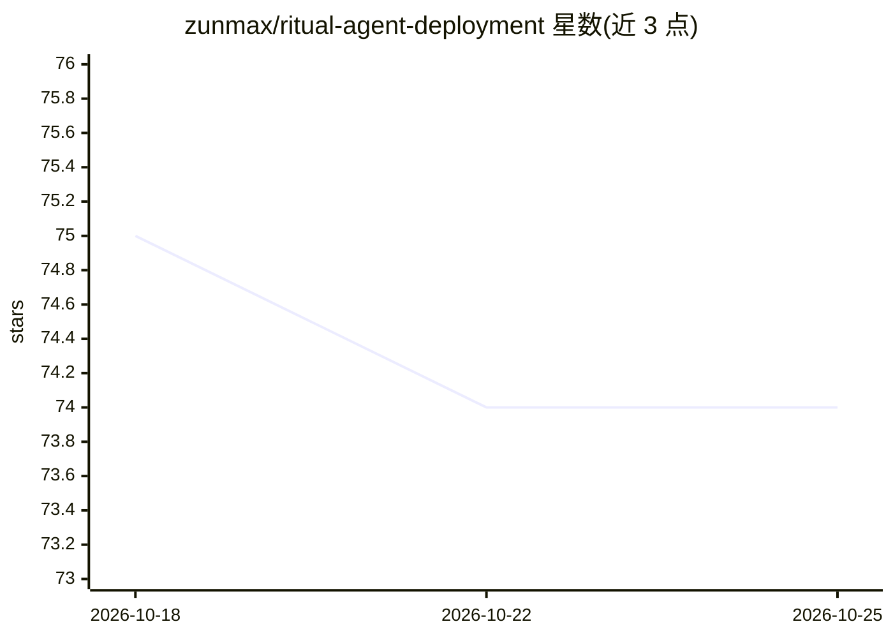

# zunmax/ritual-agent-deployment

⭐ 74 · PowerShell · MIT · 推送 2026-06-29 · [GitHub](https://github.com/zunmax/ritual-agent-deployment) · 个人维护

**一条命令在 Ritual 测试网部署自资助的链上 AI agent**

面向 Ritual 测试网的 agent 部署脚本工具：以智能合约形式部署一个按计划自我唤醒的 sovereign agent，每次唤醒在 TEE 安全飞地内运行 AI agent（模型经 Ritual 网关路由，默认 GLM-4.7-FP8，无需外部 API key），并用合约自身链上钱包余额支付运行费用。脚本自动安装 foundry、uv 等依赖，支持 Windows PowerShell 与 Linux/macOS/Git Bash/WSL，并提供 view/topup 等管理命令。已知限制：restart/withdraw/stop 因 Ritual 代理合约实现缺陷无法调用；死掉的 agent 无法通过注资复活，搁浅资金不可取回。

## 筛选速览

| 维度 | 判定 | 备注 |
|---|---|---|
| AI 角色 | `ai-ecosystem` | LLM/agent 周边工具 |
| 许可风险 | `permissive` | MIT |
| 部署形态 | `None` |  |
| 模型依赖 | — | README 未给出锁定关系 |
| 硬件要求 | — | 无带数字的原话,不猜 |
| 安装摩擦 | `low` | 无编译、无系统依赖或容器化 |
| 成熟度 | `idea` | |

## 能力要点

- 一条命令部署按计划自我唤醒的链上 sovereign agent
- 模型经 Ritual 网关路由，无需外部 API key
- 脚本自动安装 foundry、uv 等依赖
- 提供 view/topup 命令与链上浏览器健康检查

## 适用场景

- 在 Ritual 测试网上快速部署一个自资助的定时 AI agent
- 通过修改 PROMPT 定义 agent 每次唤醒执行的任务
- 管理多个 agent 合约并为其钱包充值

## 场景标签

 · 领域:区块链/AI Agent 基础设施

## 证据(README 行号)

> L3: **Deploy a recurring, sovereign AI agent on Ritual testnet with one command. No API keys.**
> L9: A *sovereign agent* is a smart contract that wakes itself on a schedule. On every wake it runs an AI agent inside a 
> L98: |`MODEL`|Model id routed through Ritual's gateway (no external key). Default `zai-org/GLM-4.7-FP8`.|

## 星数曲线

2026-10-18 75 → 2026-10-25 74（-1）

---
*卡片 v1 · prompt 1.4 · 生成 2026-10-24 · 置信度 high · 依据 README sha `e0ecbb072edf` · [字段定义](../../DATASET.md)*
