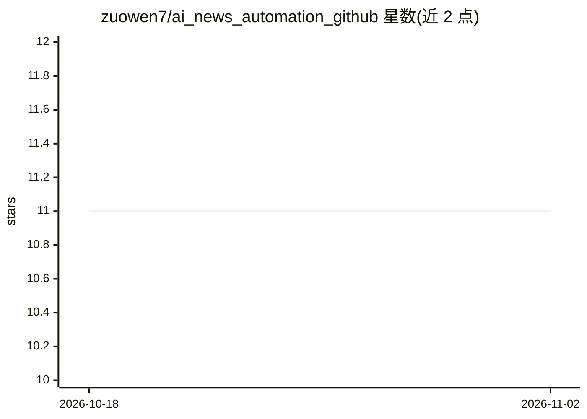

# zuowen7/ai_news_automation_github

⭐ 11 · Python · MIT · 推送 2026-03-15 · [GitHub](https://github.com/zuowen7/ai_news_automation_github) · 个人维护 · 中文 README

**多线程抓取全球 AI 新闻并用本地大模型分析摘要、邮件推送的 Python 系统**

定时从 50+ 国内外新闻源（含 GitHub Trending、Hugging Face）抓取 AI 新闻，经关键词预筛选与本地 Ollama 模型精准筛选、摘要生成、趋势分析后，以响应式 HTML 邮件推送；国内新闻用 qwen3:8b，国际新闻用 llama3.1:8b。数据自动同步 SQLite，提供 Flask Web 管理界面（仪表盘、新闻浏览、统计、配置管理）。运行依赖本地 Ollama 服务与两个 8B 模型，支持 Docker 与 GitHub Actions 定时运行。

## 筛选速览

| 维度 | 判定 | 备注 |
|---|---|---|
| AI 角色 | `ai-native` | 本体是模型或模型工具 |
| 许可风险 | `permissive` | MIT |
| 部署形态 | `self-host` | docker 或自建部署 |
| 模型依赖 | local-ok | 支持本地模型 |
| 硬件要求 | — | 无带数字的原话,不猜 |
| 安装摩擦 | `low` | 无编译、无系统依赖或容器化 |
| 成熟度 | — | 结构信号不足 |

## 能力要点

- 50+ 新闻源覆盖 8+ 地区，含 GitHub Trending 与 Hugging Face 热门项目/模型抓取
- 本地 Ollama 双模型处理：国内 qwen3:8b、国际 llama3.1:8b，零 API 费用
- Web 管理界面：Flask 3.0 + SQLAlchemy + Bootstrap 5，含仪表盘与统计分析
- 智能去重（URL 指纹+标题相似度）与 6 维度质量评分

## 适用场景

- 每天定时收一封国内外 AI 新闻摘要邮件
- 本地模型处理新闻，不调用外部 API 费用
- 通过 Web 界面浏览历史新闻与统计趋势

## 场景标签

`网页抓取` `工作流自动化` · 领域:效率与自动化

## 证据(README 行号)

> L8: 每天定时从全球新闻源抓取AI新闻，使用本地AI模型进行分类、总结，并通过邮件发送。
> L16: - **🤖 本地AI处理** - 使用Ollama，保护隐私，零API费用
> L81: ### AI处理流程

## 星数曲线

2026-10-18 11 → 2026-11-02 11（+0）

---
*卡片 v1 · prompt 1.4 · 生成 2026-11-01 · 置信度 mid · 依据 README sha `72edae1aa21f` · [字段定义](../../DATASET.md)*
