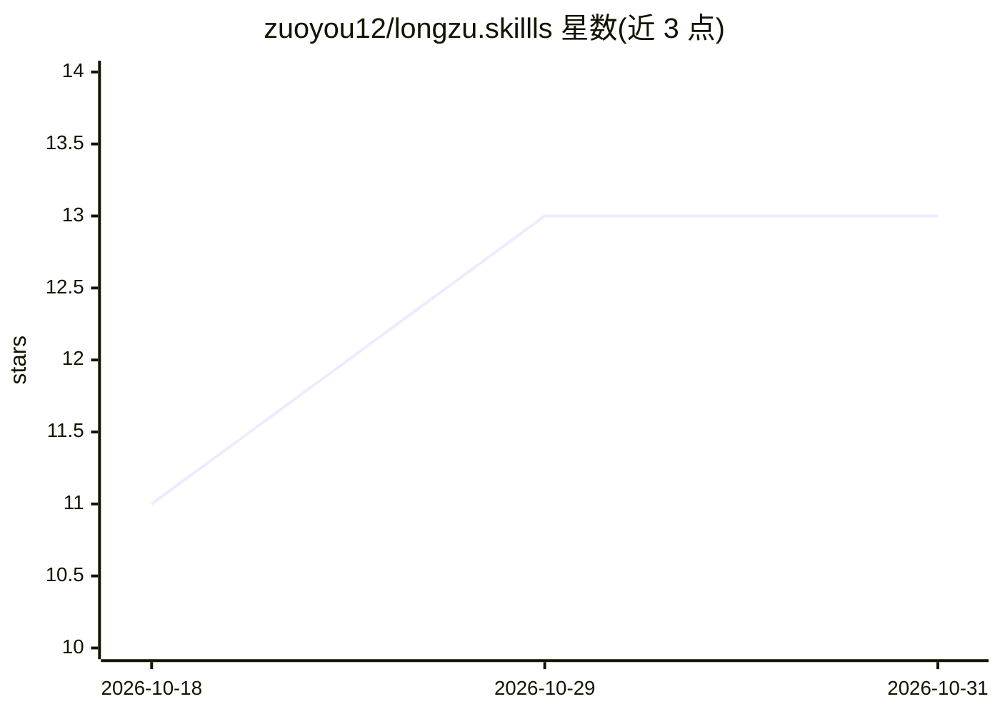

# zuoyou12/longzu.skillls

⭐ 13 · Python · NOASSERTION · 推送 2026-07-28 · [GitHub](https://github.com/zuoyou12/longzu.skillls) · 个人维护 · 中文 README

**江南×烽火戏诸侯文风蒸馏 Agent Skills，供各类 agent 生成仿写文本**

把《龙族》《剑来》共 1465 万字语料蒸馏为三个 Agent Skill（融合版 style-writer 及江南、烽火独立版），内容是 markdown 规则加一个零依赖 Python 审计脚本，可装进 Claude Code、Codex、Cursor 等任何能读文件或接受系统提示的 agent。方法论含全文量化统计、45 点等距精读采样与独立盲测（自报 95/100），并附审计脚本输出感叹号密度、句长等指标，硬性项 FAIL 返回非零退出码可挂 CI。声明为非商业同人写作辅助工具，代码以 MIT 发布，语料保真范围限定龙族期与剑来期。

## 筛选速览

| 维度 | 判定 | 备注 |
|---|---|---|
| AI 角色 | `ai-native` | 本体是模型或模型工具 |
| 许可风险 | `none` | NOASSERTION |
| 部署形态 | `None` |  |
| 模型依赖 | — | README 未给出锁定关系 |
| 硬件要求 | — | 无带数字的原话,不猜 |
| 安装摩擦 | `low` | 无编译、无系统依赖或容器化 |
| 成熟度 | — | 结构信号不足 |

## 能力要点

- 三个 Skill：融合版 style-writer（薄路由+共享骨架+皮肤按需加载，支持风格杂交）及江南、烽火独立版
- 语料方法：220万字《龙族》+1245万字《剑来》全文量化统计 + 45 点等距精读采样
- 零依赖 Python 审计脚本：标点密度/句长/段落节奏比对语料区间，硬性项 FAIL 非零退出码可挂 CI
- standalone 单文件版可直接粘贴进任意网页对话使用

## 适用场景

- 让 Claude Code/Codex/Cursor 等 agent 以江南或烽火文风写同人片段
- 对仿写草稿跑风格审计脚本，检查标点密度与对话动词是否穿帮
- 通过杂交模式组合两位作者的情绪弧线与语言皮肤

## 场景标签

`AI 写作` `提示工程` · 领域:Agent 开发

## 证据(README 行号)

> L16: *把 1465 万字原著蒸馏成可执行、可审计、可盲测复验的写作引擎。*
> L64: 技能本体只是 markdown + 一个零依赖的 Python 脚本，**任何能读文件或接受系统提示的 agent 都能用**：
> L84: - 「用江南的文笔写一段高三男生的暗恋」

## 星数曲线

2026-10-18 11 → 2026-10-31 13（+2）

---
*卡片 v1 · prompt 1.4 · 生成 2026-10-31 · 置信度 high · 依据 README sha `dd4c5b2d3b06` · [字段定义](../../DATASET.md)*
