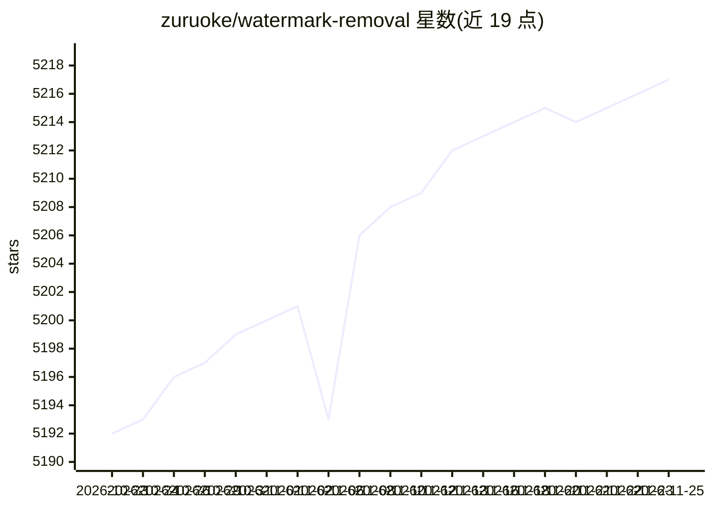

# zuruoke/watermark-removal

⭐ 5,217 · Python · MIT · 推送 2026-10-24 · [GitHub](https://github.com/zuruoke/watermark-removal) · 个人维护

**用深度学习图像修复去除图片水印的工具**

基于 TensorFlow 1.15 的图像修复（inpainting）项目，受 Contextual Attention（CVPR 2018）与 Gated Convolution（ICCV 2019）启发，对带水印图片执行去水印处理并输出修复后的图像。提供 Docker 镜像构建与容器运行两种路径，也可在 Google Colab 中以 notebook 方式运行 main.py；运行前需单独下载模型 checkpoint 目录并挂载/放置到 model/ 下。Colab 路径被标注为 broken，且需将 TensorFlow 降级至 1.15.0 并安装 neuralgym。作者提供引用条目（Zenodo DOI）。

## 筛选速览

| 维度 | 判定 | 备注 |
|---|---|---|
| AI 角色 | `ai-native` | 本体是模型或模型工具 |
| 许可风险 | `permissive` | MIT |
| 部署形态 | `self-host` | docker 或自建部署 |
| 模型依赖 | — | README 未给出锁定关系 |
| 硬件要求 | — | 无带数字的原话,不猜 |
| 安装摩擦 | `low` | 无编译、无系统依赖或容器化 |
| 成熟度 | — | 结构信号不足 |

## 能力要点

- 基于机器学习图像修复的去水印流水线
- 提供 Docker 构建/运行方式
- 支持 Google Colab 运行（标注为 broken，需 TF 1.15）
- 模型 checkpoint 需另行下载

## 适用场景

- 批量去除图片中的水印
- 在 Colab 中尝试图像修复实验

## 场景标签

`图像视频处理` · 领域:感知与多模态

## 证据(README 行号)

> L19: An open source project that uses a machine learning based image inpainting methodology to remove watermark from ima
> L21: This project was inspired by the Contextual Attention (CVPR 2018) and Gated Convolution (ICCV 2019 Oral).

## 星数曲线

2026-10-23 5,192 → 2026-11-25 5,217（+25）

---
*卡片 v1 · prompt 1.4 · 生成 2026-11-22 · 置信度 mid · 依据 README sha `815eb9f01d4c` · [字段定义](../../DATASET.md)*
