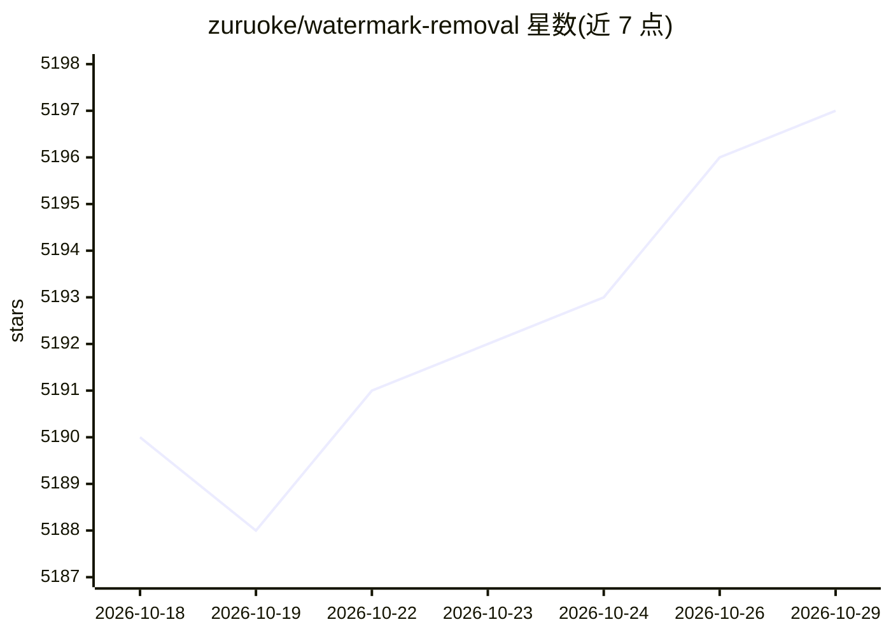

# zuruoke/watermark-removal

⭐ 5,197 · Python · MIT · 推送 2026-10-24 · [GitHub](https://github.com/zuruoke/watermark-removal) · 个人维护

**机器学习图像修复：从图片中移除水印的深度学习工具**

基于深度学习图像修复方法的图像去水印项目，通过生成式补全移除图片中的水印区域。方法源自 Contextual Attention（CVPR 2018）与 Gated Convolution（ICCV 2019）两篇论文的思路实现。提供 Docker 与 Google Colab 两种运行途径（README 标注 Colab 路径 broken），需自行下载预训练模型目录，运行时依赖 TensorFlow 1.15.0 与 neuralgym 工具包，支持指定水印类型（如 istock）处理输入图像并输出结果。

## 筛选速览

| 维度 | 判定 | 备注 |
|---|---|---|
| AI 角色 | `ai-native` | 本体是模型或模型工具 |
| 许可风险 | `none` | MIT |
| 部署形态 | `self-host` | docker 或自建部署 |
| 模型依赖 | — | README 未给出锁定关系 |
| 硬件要求 | — | 无带数字的原话,不猜 |
| 安装摩擦 | `low` | 无编译、无系统依赖或容器化 |
| 成熟度 | — | 结构信号不足 |

## 能力要点

- 基于生成式图像修复（Contextual Attention / Gated Convolution）的去水印
- 提供 Docker 镜像构建与容器化运行流程
- 支持 --watermark_type 参数按水印类型处理（如 istock）

## 适用场景

- 我需要去除图片上指定类型的水印
- 想用预训练模型跑通图像补全去水印流程

## 场景标签

`图像视频处理` · 领域:感知与多模态

## 证据(README 行号)

> L17: An open source project that uses a machine learning based image inpainting methodology to remove watermark from ima
> L19: This project was inspired by the Contextual Attention (CVPR 2018) and Gated Convolution (ICCV 2019 Oral).

## 星数曲线

2026-10-18 5,190 → 2026-10-29 5,197（+7）

---
*卡片 v1 · prompt 1.4 · 生成 2026-10-20 · 置信度 mid · 依据 README sha `c543cc5fbdc2` · [字段定义](../../DATASET.md)*
