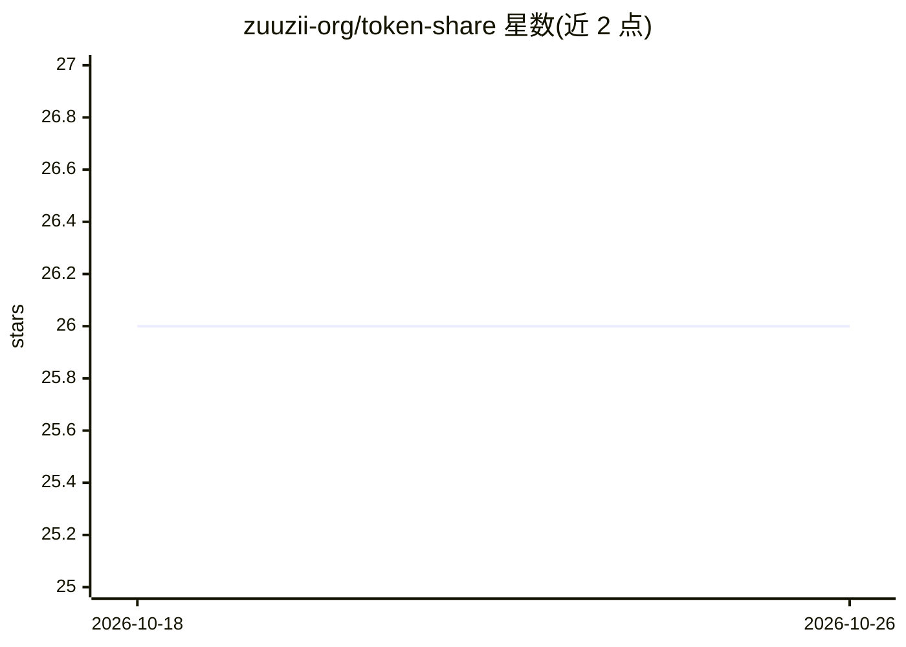

# zuuzii-org/token-share

⭐ 26 · Swift · Apache-2.0 · 推送 2026-06-03 · [GitHub](https://github.com/zuuzii-org/token-share) · 个人维护 · 中文 README

**macOS 菜单栏 LLM API 网关：本地互译 OpenAI 与 Anthropic 协议**

用 Swift 6.1 编写的 macOS 原生菜单栏应用，作为本地 LLM API 网关运行：在 OpenAI Chat Completions、OpenAI Responses 与 Anthropic Messages 三种协议间任意方向实时互译，SSE 流式逐事件转换（含文本增量、工具调用与流式中断）。支持配置任意数量上游并热切换，自动拉取上游模型列表。全部流量走 localhost:9091，无注册、无遥测。要求 macOS 14+、Xcode 16+、Swift 6+，可从源码构建或 GitHub Release 下载（未做 Apple 公证）。

## 筛选速览

| 维度 | 判定 | 备注 |
|---|---|---|
| AI 角色 | `ai-ecosystem` | LLM/agent 周边工具 |
| 许可风险 | `permissive` | Apache-2.0 |
| 部署形态 | `None` |  |
| 模型依赖 | — | README 未给出锁定关系 |
| 硬件要求 | — | 无带数字的原话,不猜 |
| 安装摩擦 | `low` | 无编译、无系统依赖或容器化 |
| 成熟度 | — | 结构信号不足 |

## 能力要点

- 三种协议（Chat Completions / Responses / Messages）任意方向互译
- SSE 流式逐事件转换，覆盖工具调用与流式中断
- 多上游配置一键热切换，自动同步模型列表
- 纯本地运行，无注册、无遥测

## 适用场景

- 让仅支持 OpenAI 协议的客户端接入 Anthropic 上游（或反之）
- 在多个上游服务商之间本地热切换
- 本地统一代理并流式转发 LLM 请求

## 场景标签

 · 领域:LLM 基础设施/API 网关

## 证据(README 行号)

> L5: **macOS 原生菜单栏 LLM API 网关**
> L17: - **协议互译** — OpenAI Chat Completions · OpenAI Responses · Anthropic Messages，任意方向

## 星数曲线

2026-10-18 26 → 2026-10-26 26（+0）

---
*卡片 v1 · prompt 1.4 · 生成 2026-10-26 · 置信度 high · 依据 README sha `9de671f29155` · [字段定义](../../DATASET.md)*
