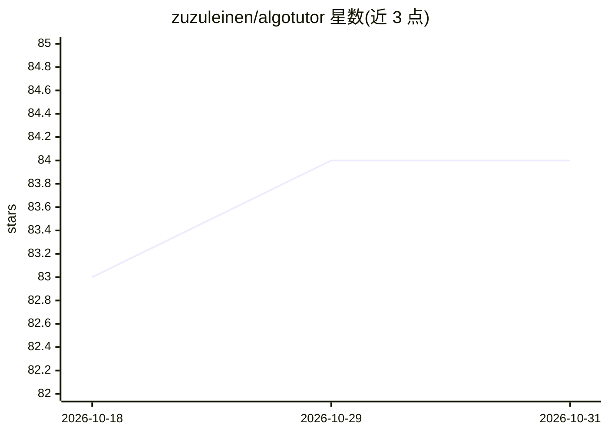

# zuzuleinen/algotutor

⭐ 84 · Go · MIT · 推送 2026-07-10 · [GitHub](https://github.com/zuzuleinen/algotutor) · [官网](https://algotutor.ai) · 个人维护

**面向 Go 开发者的 AI 辅导训练工具：Agent 生成递进算法题**

配合 AI 编码 Agent 使用的训练工具（agent-agnostic）：用户选择自己的 agent 作为私人导师，系统生成难度递进的题目，追踪各概念的技能水平并据此选题；提供 train/check/review 工作流，支持间隔复习（每日 review TUI）与提交评分、错误记录。当前课程含算法与数据结构、并发两门。通过 git clone + make 命令本地运行，要求已配置支持的 AI 编码 agent 与 Go ≥ 1.26。

## 筛选速览

| 维度 | 判定 | 备注 |
|---|---|---|
| AI 角色 | `ai-native` | 本体是模型或模型工具 |
| 许可风险 | `permissive` | MIT |
| 部署形态 | `None` |  |
| 模型依赖 | — | README 未给出锁定关系 |
| 硬件要求 | — | 无带数字的原话,不猜 |
| 安装摩擦 | `low` | 无编译、无系统依赖或容器化 |
| 成熟度 | — | 结构信号不足 |

## 能力要点

- Agent 无关设计，用户自带 AI 编码 agent 作为导师
- 按技能水平生成递进难度题目并追踪进度
- 间隔复习：每日 review TUI 跨课程复习
- 聊天命令：check 评分、'I don't know' 换简单题

## 适用场景

- 我想系统训练 Go 的算法与数据结构
- 我想通过 AI 导师逐步攻克并发编程
- 我想每日做间隔复习巩固已学概念

## 场景标签

 · 领域:开发者教育/训练工具

## 证据(README 行号)

> L11: Your agent acts as your personal tutor, generating progressively harder problems. It tracks your skill level on eac
> L73: - An AI coding agent — see docs/agents.md for the supported list and setup

## 星数曲线

2026-10-18 83 → 2026-10-31 84（+1）

---
*卡片 v1 · prompt 1.4 · 生成 2026-10-24 · 置信度 high · 依据 README sha `45a04d3c69ee` · [字段定义](../../DATASET.md)*
