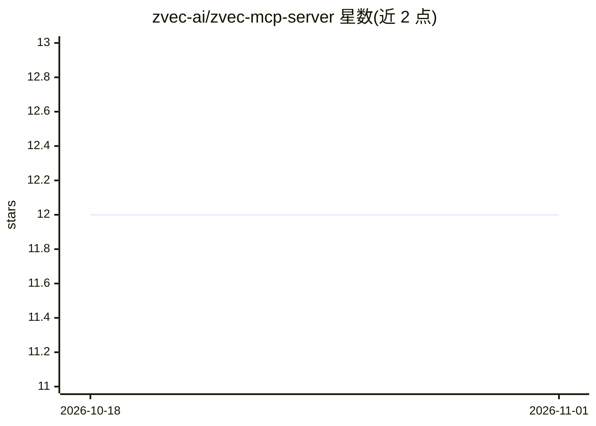

# zvec-ai/zvec-mcp-server

⭐ 12 · Python · Apache-2.0 · 推送 2026-04-15 · [GitHub](https://github.com/zvec-ai/zvec-mcp-server) · [官网](https://zvec.org/en/) · 组织维护 · 中文 README

**让 LLM 通过 MCP 操作 Zvec 向量数据库的服务器**

Zvec（阿里巴巴嵌入式向量数据库）官方 MCP 服务器，向 LLM 提供 17 个工具：集合管理、文档 CRUD、单/多向量检索（Weighted/RRF 重排）、HNSW/IVF/FLAT 索引管理，以及基于 OpenAI API 的文本嵌入生成、自动嵌入写入与语义搜索（需 OPENAI_API_KEY，可用 DashScope 端点）。输入经 Pydantic v2 校验，输出支持 JSON/Markdown。通过 pip 安装后可接入 Qoder、Cursor、Claude Desktop 等 MCP 客户端，支持 Linux/macOS/Windows 与 Python 3.10-3.14。

## 筛选速览

| 维度 | 判定 | 备注 |
|---|---|---|
| AI 角色 | `ai-ecosystem` | LLM/agent 周边工具 |
| 许可风险 | `permissive` | Apache-2.0 |
| 部署形态 | `library` | 以包/库形式分发 |
| 模型依赖 | — | README 未给出锁定关系 |
| 硬件要求 | — | 无带数字的原话,不猜 |
| 安装摩擦 | `low` | 无编译、无系统依赖或容器化 |
| 成熟度 | — | 结构信号不足 |

## 能力要点

- 17 个工具覆盖集合/文档/检索/索引/嵌入五类操作
- 内置 OpenAI 嵌入与自然语言语义搜索（embedding_search）
- 多向量检索支持 Weighted 与 RRF 重排策略
- 兼容 Qoder/Cursor/Claude Desktop 的 MCP 配置

## 适用场景

- 在 IDE 或 MCP 客户端中让 LLM 直接操作向量库集合与文档
- 对话式执行语义搜索与自动嵌入写入
- 管理 Zvec 的 HNSW/IVF/FLAT 索引与混合检索

## 场景标签

`向量数据库` `语义搜索` · 领域:知识与检索

## 证据(README 行号)

> L3: A Model Context Protocol (MCP) server for Zvec, a high-performance embedded vector database by Alibaba.
> L7: This MCP server enables LLMs to interact with Zvec vector database through well-designed tools. It provides comprehe

## 星数曲线

2026-10-18 12 → 2026-11-01 12（+0）

---
*卡片 v1 · prompt 1.4 · 生成 2026-10-31 · 置信度 high · 依据 README sha `65fda5f782ca` · [字段定义](../../DATASET.md)*
