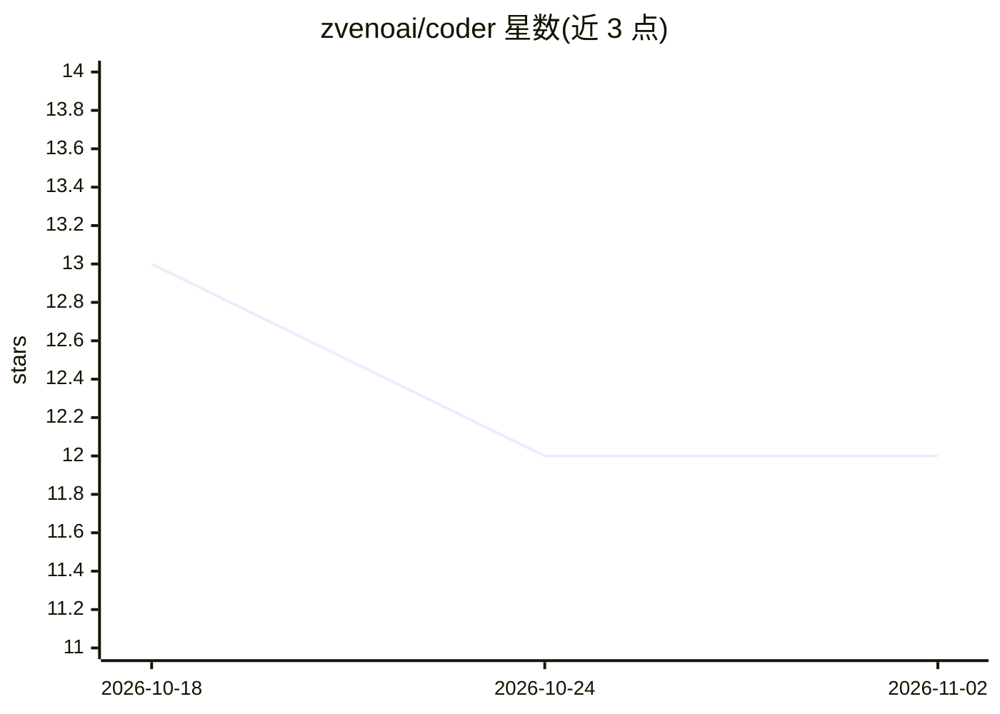

# zvenoai/coder

⭐ 12 · Python · Apache-2.0 · 推送 2026-09-28 · [GitHub](https://github.com/zvenoai/coder) · [官网](https://zveno.ai) · 组织维护

**面向企业开发流程的异步 AI 编码编排器，自动完成任务到 PR 全流程**

基于 Python/FastAPI 的异步编排系统：轮询 Yandex Tracker 中标记 ai-task 的任务，调用 Claude Agent SDK 启动编码代理，按依赖协调史诗子任务并自动分解；流程覆盖 TDD 实现、PR 创建、评审评论处理、human gate、Sonnet 子代理 pre-merge code review、自动合并、部署后验证与告警接入，并带实时 Web 仪表盘与 Supervisor 心跳监控。面向已使用 Yandex Tracker + GitHub 的团队，要求 Docker Compose（本地）或 Kubernetes+Helm（生产）环境，需 Claude API 访问（Anthropic 或 ZvenoAI 中转）。

## 筛选速览

| 维度 | 判定 | 备注 |
|---|---|---|
| AI 角色 | `ai-native` | 本体是模型或模型工具 |
| 许可风险 | `permissive` | Apache-2.0 |
| 部署形态 | `self-host` | docker 或自建部署 |
| 模型依赖 | locked-api |  |
| 硬件要求 | — | 无带数字的原话,不猜 |
| 安装摩擦 | `low` | 无编译、无系统依赖或容器化 |
| 成熟度 | — | 结构信号不足 |

## 能力要点

- Yandex Tracker 任务自动转 Claude 代理工作流并产出 GitHub PR
- human gate + pre-merge code review + post-merge 部署验证的自动合并管线
- 史诗子任务依赖协调与自动分解，重启后按 session_id 恢复代理上下文
- Supervisor 心跳监控、Alertmanager 告警转任务、Prometheus 指标与实时仪表盘

## 适用场景

- 把项目管理系统中的任务自动交给 AI 代理实现并提 PR
- 在带人工审查关卡的前提下自动合并通过评审的 PR
- 运维侧把 Alertmanager 告警自动转为开发任务

## 场景标签

`编码 Agent` `代码审查` `多智能体` · 领域:Agent 开发

## 证据(README 行号)

> L9: Асинхронный оркестратор на Python: опрашивает Yandex Tracker на задачи с тегом `ai-task`, запускает агентов Claude д
> L30: **Жизненный цикл:** опрос трекера → если задача — эпик: регистрация и координация подзадач через OrchestratorAgent 
> L112: - **Claude API** — OAuth-токен Claude Code или API-ключ (Anthropic / ZvenoAI)

## 星数曲线

2026-10-18 13 → 2026-11-02 12（-1）

---
*卡片 v1 · prompt 1.4 · 生成 2026-10-31 · 置信度 mid · 依据 README sha `b77855bdb377` · [字段定义](../../DATASET.md)*
