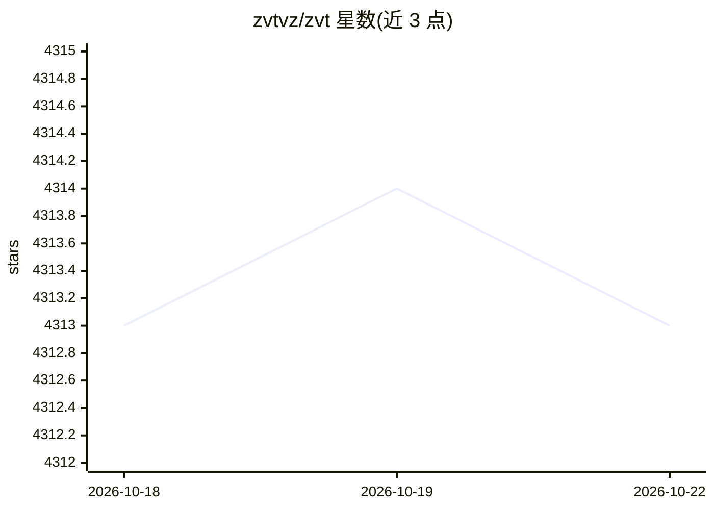

# zvtvz/zvt

⭐ 4,315 · Python · MIT · 推送 2026-07-01 · [GitHub](https://github.com/zvtvz/zvt) · [官网](https://zvt.readthedocs.io/en/latest/) · 个人维护 · 中文 README

**模块化量化投研框架：数据采集、因子计算、策略回测一体化**

面向量化交易研究者的 Python 框架，围绕 TradableEntity 与 EntityEvent 两个核心概念组织：对股票（中国/美国/香港）、指数、财报因子等提供统一的 record_data/query_data 接口，支持多数据源（东财、聚宽、新浪、交易所）与增量更新；内置二维索引多实体因子计算模型、solo 与 formal 两种策略编写模式和回测。提供 Dash UI 与 REST API + 独立前端两种界面，含机器学习模块（如 MaStockMLMachine 可完成数据采集到预测展示）。声明不保证向后兼容，部分模块可能不再维护。

## 筛选速览

| 维度 | 判定 | 备注 |
|---|---|---|
| AI 角色 | `ai-enhanced` | 去掉 AI 部分产品仍成立 |
| 许可风险 | `permissive` | MIT |
| 部署形态 | `library` | 以包/库形式分发 |
| 模型依赖 | — | README 未给出锁定关系 |
| 硬件要求 | — | 无带数字的原话,不猜 |
| 安装摩擦 | `low` | 无编译、无系统依赖或容器化 |
| 成熟度 | — | 结构信号不足 |

## 能力要点

- 统一 schema 的数据采集/查询接口，多数据源可切换并增量更新
- 二维索引多实体因子计算模型与目标选择器
- Dash UI（回测研究）与 REST API + 独立前端（实时行情）两种界面
- ML 模块可用几行代码完成数据持久化、训练预测与展示

## 适用场景

- 采集并本地查询中/美/港股行情与财报数据
- 编写技术因子与事件驱动策略并回测查看绩效
- 在全市场数据上按财务条件做选股筛选

## 场景标签

`金融量化` · 领域:学习与行业

## 证据(README 行号)

> L98: >>> from zvt.ml import MaStockMLMachine
> L103: > The few lines of code above has done: data capture, persistence, incremental update, machine learning, predictio

## 星数曲线

2026-10-18 4,313 → 2026-10-22 4,313（+0）

---
*卡片 v1 · prompt 1.4 · 生成 2026-10-21 · 置信度 mid · 依据 README sha `92ef1fcd04b2` · [字段定义](../../DATASET.md)*
