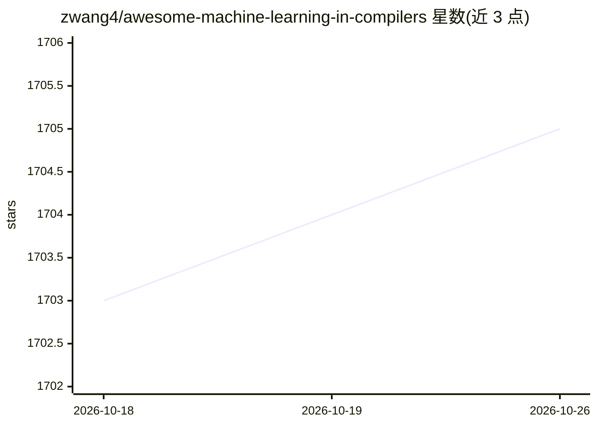

# zwang4/awesome-machine-learning-in-compilers

⭐ 1,705 · CC0-1.0 · 推送 2026-08-26 · [GitHub](https://github.com/zwang4/awesome-machine-learning-in-compilers) · 个人维护

**机器学习用于编译器与程序优化的论文/数据集/工具策展清单**

由 Zheng Wang 维护的 awesome 类策展清单，收录将机器学习技术应用于编译器与程序优化领域的研究论文、数据集和工具。论文部分按主题组织：综述、迭代编译与编译选项调优、指令级优化、自动调优与设计空间探索等，条目标注页数、作者与发表会议/期刊（CGO、PLDI、PLDI、NeurIPS、ACM TACO 等），覆盖 1998 年至 2026 年的文献，含 LLM 与编译器协同方向的综述。面向该方向的研究者与开发者作文献导航使用，本身不提供可安装的软件或数据。

## 筛选速览

| 维度 | 判定 | 备注 |
|---|---|---|
| AI 角色 | `ai-knowledge` | 知识聚合/清单类 |
| 许可风险 | `viral` | CC0-1.0 |
| 部署形态 | `None` |  |
| 模型依赖 | — | README 未给出锁定关系 |
| 硬件要求 | — | 无带数字的原话,不猜 |
| 安装摩擦 | `low` | 无编译、无系统依赖或容器化 |
| 成熟度 | — | 结构信号不足 |

## 能力要点

- 按综述/选项调优/指令级优化/自动调优等主题分类组织论文
- 条目标注页数、作者、发表会议与年份
- 覆盖深度学习编译器与 LLM+编译器方向的综述

## 适用场景

- 查找编译器机器学习方向的研究文献与综述
- 了解编译器自动调优与指令级优化的研究脉络
- 定位该领域可用的数据集与工具链接

## 场景标签

`精选清单` · 领域:学习与行业

## 证据(README 行号)

> L5: A curated list of awesome research papers, datasets, and tools for applying machine learning techniques to compilers
> L9: ## Papers

## 星数曲线

2026-10-18 1,703 → 2026-10-26 1,705（+2）

---
*卡片 v1 · prompt 1.4 · 生成 2026-10-21 · 置信度 high · 依据 README sha `af5f0c0f78af` · [字段定义](../../DATASET.md)*
