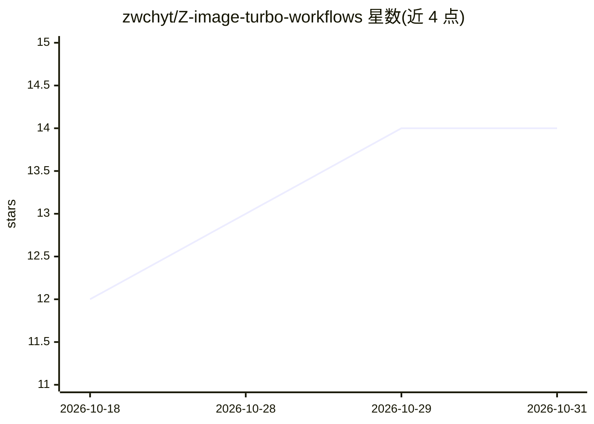

# zwchyt/Z-image-turbo-workflows

⭐ 14 · 推送 2026-01-14 · [GitHub](https://github.com/zwchyt/Z-image-turbo-workflows) · 个人维护 · 中文 README

**Z-Image-Turbo 文生图 ComfyUI 工作流配置与安装指南**

面向 ComfyUI 用户的 Z-Image-Turbo 文生图工作流仓库：提供 z-image.json 工作流文件，配套说明 UNet/CLIP(Qwen3-4B)/VAE 三类模型的手动放置路径与 Hugging Face 下载链接，列举 Efficiency Nodes、Easy-Use 等可选插件节点包及其 git clone 或 ComfyUI-Manager 安装方式。工作流支持图片反推中文提示词、生成结果保存至 output 目录，并附注意力加速（flash-attn2 等）、LoRA、缓存加速推荐与预设采样参数（4-8 步、CFG 1）。

## 筛选速览

| 维度 | 判定 | 备注 |
|---|---|---|
| AI 角色 | `ai-ecosystem` | LLM/agent 周边工具 |
| 许可风险 | `none` | — |
| 部署形态 | `library` | 以包/库形式分发 |
| 模型依赖 | — | README 未给出锁定关系 |
| 硬件要求 | — | 无带数字的原话,不猜 |
| 安装摩擦 | `low` | 无编译、无系统依赖或容器化 |
| 成熟度 | — | 结构信号不足 |

## 能力要点

- 提供 z-image.json 可拖入 ComfyUI 的完整工作流
- 列出 UNet/CLIP/VAE 模型放置路径与下载链接
- 含 7 个可选插件节点包及两种安装方式说明
- 附注意力加速、LoRA 与缓存加速推荐及预设参数

## 适用场景

- 在 ComfyUI 中跑通 Z-Image-Turbo 文生图
- 上传人像图反推中文提示词再生成图片
- 按清单准备模型与插件环境

## 场景标签

`图像生成` · 领域:内容生成

## 证据(README 行号)

> L29: 1. 将本仓库中的 `z-image.json` 拖入 ComfyUI 界面
> L7: |UNet模型加载器|`z_image_turbo_bf16.safetensors/z-image-turbo-fp8-e4m3fn.safetensors`|`ComfyUI\models\diffusion_models\`|

## 星数曲线

2026-10-18 12 → 2026-10-31 14（+2）

---
*卡片 v1 · prompt 1.4 · 生成 2026-10-31 · 置信度 mid · 依据 README sha `3d9b897299cd` · [字段定义](../../DATASET.md)*
