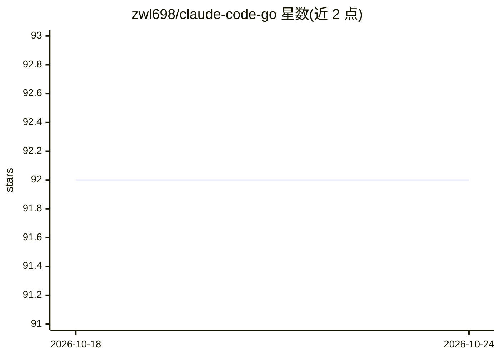

# zwl698/claude-code-go

⭐ 92 · Go · 推送 2026-04-08 · [GitHub](https://github.com/zwl698/claude-code-go) · [官网](https://linux.do/u/huo0) · 个人维护 · 中文 README

**Claude Code 的非官方 Go 语言重实现（AI 编程 CLI）**

从 @anthropic-ai/claude-code npm 包 v2.1.88 的 Source Map 还原出 TypeScript 源码（4756 个文件）后翻译为 Go 的非官方实现，仅供研究使用。功能包括 OAuth 认证、多云供应商接入（AWS Bedrock/Google Vertex/Azure Foundry）、MCP 协议（stdio/SSE/WebSocket）、Bash 安全解析、LSP 服务、工具/权限/Hooks 系统、Vim 模式、语音交互与 Bubble Tea UI。编译为单二进制运行，需 Go 1.26+ 与 Anthropic API 密钥或 OAuth 认证。源码版权归 Anthropic 所有，禁止商业使用。

## 筛选速览

| 维度 | 判定 | 备注 |
|---|---|---|
| AI 角色 | `ai-native` | 本体是模型或模型工具 |
| 许可风险 | `none` | — |
| 部署形态 | `None` |  |
| 模型依赖 | locked-api |  |
| 硬件要求 | — | 无带数字的原话,不猜 |
| 安装摩擦 | `low` | 无编译、无系统依赖或容器化 |
| 成熟度 | — | 结构信号不足 |

## 能力要点

- 基于 Source Map 还原 4756 个文件并翻译为 Go 单二进制
- 支持 Anthropic API 及 AWS Bedrock / Google Vertex / Azure Foundry 多云认证
- MCP 协议（stdio/SSE/WebSocket）、LSP、权限系统、Hooks、Vim 模式、语音交互等模块已完成
- 编译后单可执行文件，无 Node.js 运行时依赖

## 适用场景

- 在命令行中使用 AI 助手进行代码审查、重构、调试与测试生成
- 以单二进制形式在 Linux/macOS/Windows 部署 AI 编程 CLI
- 研究 Claude Code 的内部实现结构（含还原的 TypeScript 源码）
- 通过 AWS Bedrock / Vertex / Azure 等企业渠道接入模型

## 场景标签

 · 领域:AI 编程工具/开发者工具

## 证据(README 行号)

> L14: Claude Code 是 Anthropic 官方推出的 AI 编程助手命令行工具，可以帮助开发者：
> L23: 本项目通过 `@anthropic-ai/claude-code` npm 发布包内附带的 Source Map（`cli.js.map`）还原了 TypeScript 源码（版本 2.1.88），并将其翻译为 Go 语言实现。
> L31: - **单二进制分发**：无需 Node.js 运行时，编译后单个可执行文件即可运行

## 星数曲线

2026-10-18 92 → 2026-10-24 92（+0）

---
*卡片 v1 · prompt 1.4 · 生成 2026-10-23 · 置信度 high · 依据 README sha `cc18c84f05cc` · [字段定义](../../DATASET.md)*
