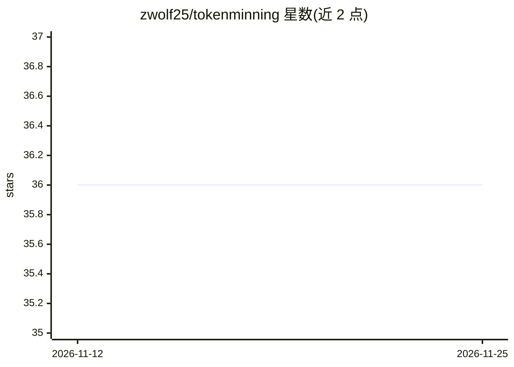

# zwolf25/tokenminning

⭐ 36 · Python · MIT · 推送 2026-11-19 · [GitHub](https://github.com/zwolf25/tokenminning) · [官网](https://medium.com/@zwolf25) · 个人维护

**上下文工程方法论：提升 LLM 每-token 信息密度的原则与案例集**

一个围绕“最大化每 token 智能”的设计哲学与方法论仓库：提出 7 条原则（按需检索、压缩不重复、结构化等）、13 项技术（Stub Pattern、Grep-before-read、三级升级梯子、零-token 文档处理等），并附生产环境 Second Brain 工作流的 before/after 度量结果（如 wiki 词数 211K→28K、每轮成本降低），证据级别分别标注 measured/estimated/single run。提供 Quick Start 脚本审计自身会话加载内容，面向使用 Claude Code 等 agent 工具的开发者。

## 筛选速览

| 维度 | 判定 | 备注 |
|---|---|---|
| AI 角色 | `ai-knowledge` | 知识聚合/清单类 |
| 许可风险 | `permissive` | MIT |
| 部署形态 | `None` |  |
| 模型依赖 | — | README 未给出锁定关系 |
| 硬件要求 | — | 无带数字的原话,不猜 |
| 安装摩擦 | `low` | 无编译、无系统依赖或容器化 |
| 成熟度 | `idea` | |

## 能力要点

- 7 条原则 + 13 项上下文优化技术的方法论体系
- 三级升级梯子：本地缓存→stub 查找→按需读取，默认不加载
- 生产案例的 before/after 度量结果，逐项标注证据级别（measured/estimated/single run）
- Quick Start 提供可运行的 stdlib Python 审计脚本（只读、不写入）

## 适用场景

- 我在用 Claude Code 等 agent 工具时想审计和削减常驻上下文
- 我想用升级梯子模式重构 RAG 或文档流水线，降低 token 成本
- 我想参考生产案例的实测数据评估上下文优化收益

## 场景标签

`提示工程` · 领域:Agent 开发

## 证据(README 行号)

> L44: Tokenminning is a design philosophy; the tools here measure it on your own setup. Three steps, about five minutes:
> L55: ## Principles
> L151: > These are *technique guides* — not measured case studies. Case studies in `examples/` (`second-brain-system.md`,

## 星数曲线

2026-11-12 36 → 2026-11-25 36（+0）

---
*卡片 v1 · prompt 1.4 · 生成 2026-11-18 · 置信度 high · 依据 README sha `84488ab89538` · [字段定义](../../DATASET.md)*
