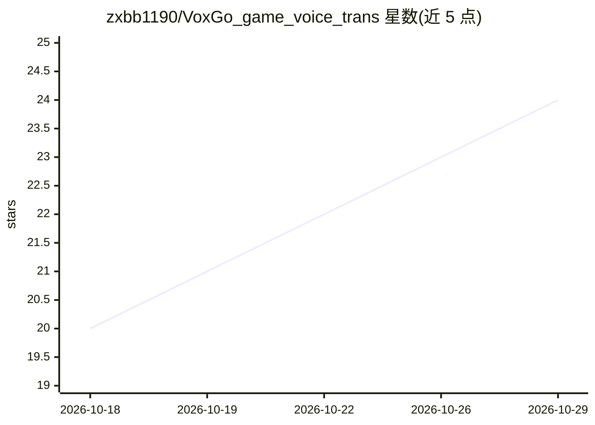

# zxbb1190/VoxGo_game_voice_trans

⭐ 24 · Python · GPL-3.0 · 推送 2026-10-21 · [GitHub](https://github.com/zxbb1190/VoxGo_game_voice_trans) · [官网](http://voxgo.cn/) · 个人维护 · 中文 README

**给 PC 游戏玩家的实时语音翻译浮窗，识别并翻译游戏语音**

面向 PC 游戏玩家的开源桌面工具：用 WASAPI Loopback 捕获系统音频，基于 faster-whisper 做离线中/英语音识别，经 OpenAI 兼容接口或 Google Cloud Translation、或本地 OPUS-MT 离线模型完成中英双向翻译，结果以透明置顶浮窗显示在游戏内，并支持 WebSocket 推送到手机浏览器。当前识别与翻译仅正式支持英语和中文双向。Windows 提供 Lite/Full/Full-CUDA 三种免安装包，也可 pip 安装依赖后从源码运行。

## 筛选速览

| 维度 | 判定 | 备注 |
|---|---|---|
| AI 角色 | `ai-native` | 本体是模型或模型工具 |
| 许可风险 | `viral` | GPL-3.0 |
| 部署形态 | `desktop` | 安装包/桌面程序 |
| 模型依赖 | — | README 未给出锁定关系 |
| 硬件要求 | — | 无带数字的原话,不猜 |
| 安装摩擦 | `medium` | 含编译或系统依赖之一 |
| 成熟度 | — | 结构信号不足 |

## 能力要点

- faster-whisper 离线语音识别，支持 CPU/CUDA
- WASAPI Loopback 捕获系统音频而非麦克风
- 翻译支持 OpenAI 兼容 API、Google Cloud Translation 及本地 OPUS-MT 离线模型
- 游戏内透明置顶浮窗与手机浏览器同步显示

## 适用场景

- 海外服开黑、公会语音时把队友语音实时翻译成字幕
- 直播时生成实时字幕
- Discord 队友沟通的中英互译

## 场景标签

`语音识别` · 领域:感知与多模态

## 证据(README 行号)

> L7: VoxGo 是一个面向 PC 游戏玩家的开源实时语音翻译浮窗工具，适合海外服开黑、公会语音、Discord 队友沟通和直播字幕辅助。
> L16: - **实时音频捕获**: 使用 WASAPI Loopback 捕获系统音频输出（不是麦克风）
> L17: - **本地语音识别**: 基于 faster-whisper 的离线语音转文字，当前支持固定英语/中文识别

## 星数曲线

2026-10-18 20 → 2026-10-29 24（+4）

---
*卡片 v1 · prompt 1.4 · 生成 2026-10-27 · 置信度 high · 依据 README sha `a1afc1fe1c49` · [字段定义](../../DATASET.md)*
