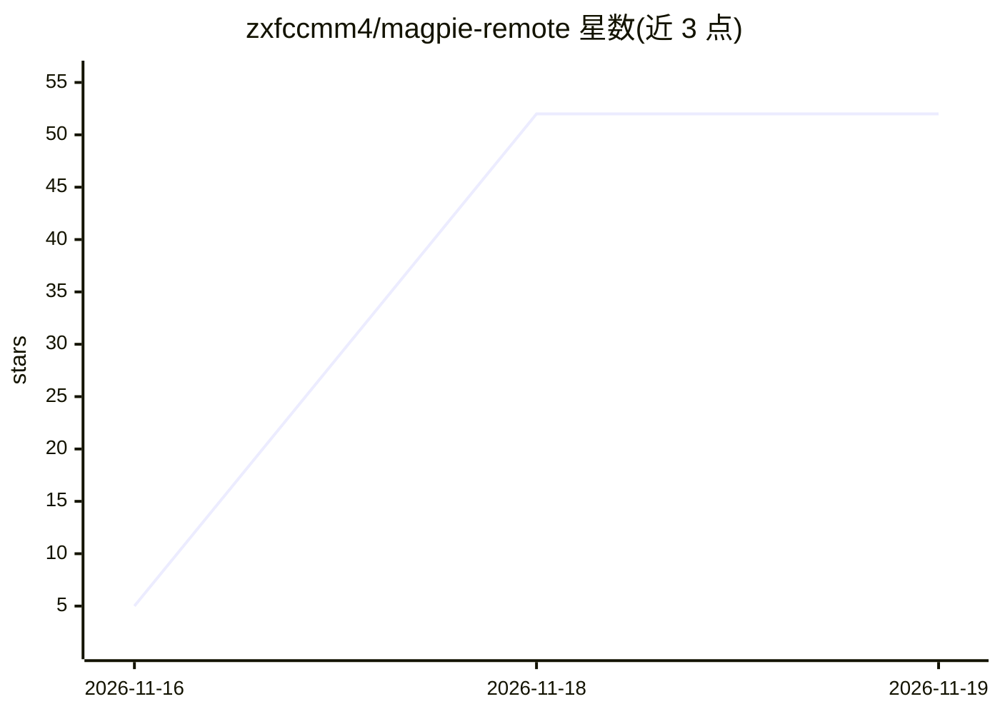

# zxfccmm4/magpie-remote

⭐ 52 · Swift · 推送 2026-11-17 · [GitHub](https://github.com/zxfccmm4/magpie-remote) · [官网](https://github.com/zxfccmm4/magpie-remote/releases/latest) · 个人维护 · 中文 README

**为 magpie AI 网关打造的 iOS/iPadOS 原生控制中心**

yetone/magpie 的原生 Apple 客户端：用 SwiftUI 实现，无 WebView 壳与第三方依赖，通过 Web Key 连接自部署的 magpie 服务器。功能覆盖 Agent（Claude Code、Codex、Gemini 等）配置管理、70+ 预置 Provider 的多账号轮询池与连通性诊断、路由策略组编辑、实时 token 用量统计、会话转录回看、网关凭据与滑动窗口配额、敏感信息脱敏规则及 Skills/MCP 市场管理。安装途径为 GitHub Releases 的 ipa（TrollStore/AltStore 侧载）或 XcodeGen + Xcode 源码构建，需 iOS 26.0+。

## 筛选速览

| 维度 | 判定 | 备注 |
|---|---|---|
| AI 角色 | `ai-ecosystem` | LLM/agent 周边工具 |
| 许可风险 | `none` | — |
| 部署形态 | `None` |  |
| 模型依赖 | — | README 未给出锁定关系 |
| 硬件要求 | — | 无带数字的原话,不猜 |
| 安装摩擦 | `low` | 无编译、无系统依赖或容器化 |
| 成熟度 | — | 结构信号不足 |

## 能力要点

- 100% SwiftUI 原生实现，零第三方依赖，凭据存系统 Keychain
- 管理 70+ 预置 Provider，支持多账号轮询池与连通性诊断
- 实时路由决策流与历史路由回溯可视化
- 内置 Skills.sh 与 MCP Registry 市场，一键安装技能和 MCP 服务器

## 适用场景

- 在 iPhone/iPad 上随时管理自部署 magpie 网关的 Provider 与路由
- 查看 agent 的 token 用量、请求台账与配额消耗
- 回看历史会话转录并跨 agent 携带上下文

## 场景标签

 · 领域:LLM 基础设施/网关管理

## 证据(README 行号)

> L7:  A native Apple control center built for yetone/magpie
> L19: magpie is a powerful, elegant open-source AI agent gateway and routing middleware. Magpie Remote brings its daily o

## 星数曲线

2026-11-16 5 → 2026-11-19 52（+47）

---
*卡片 v1 · prompt 1.4 · 生成 2026-11-18 · 置信度 high · 依据 README sha `c8df2cb2f4da` · [字段定义](../../DATASET.md)*
