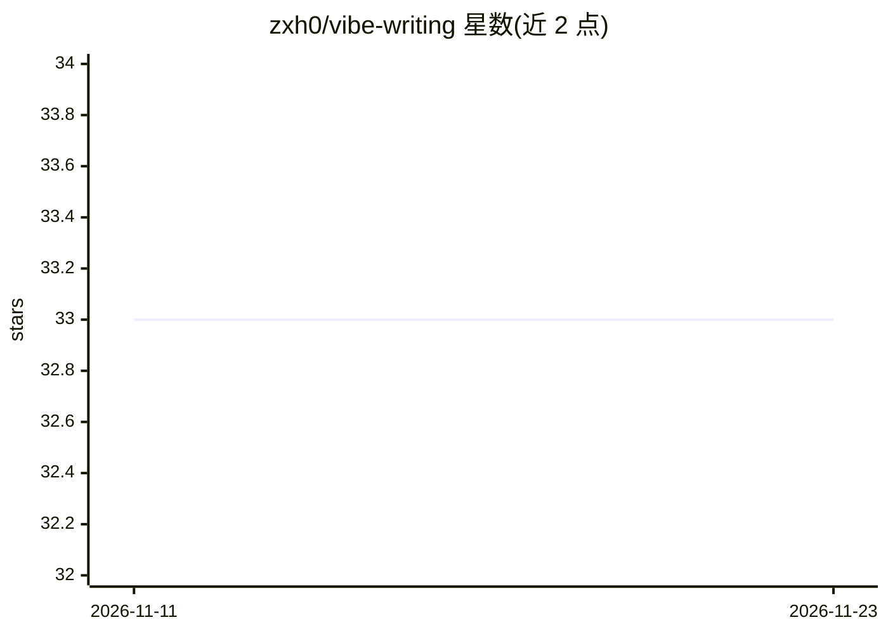

# zxh0/vibe-writing

⭐ 33 · Python · CC0-1.0 · 推送 2026-11-22 · [GitHub](https://github.com/zxh0/vibe-writing) · [官网](https://zxh0.github.io/vibe-writing/) · 个人维护 · 中文 README

**LLM/深度学习图解笔记与 AI 书籍的写作仓库**

个人维护的技术写作项目，收录 LLM 学习笔记（15 篇）及多本写作中或计划中的 AI 书籍，覆盖神经网络入门、手写 LLM 推理引擎、LLM 训练、智能体实现、深度学习框架实现、GPU 与 TU 设计。内容以在线站点形式发布，支持全文搜索与公式渲染；站点由 scripts/build-site.mjs 从各目录生成，npm run build 构建，推送 main 分支后自动部署。

## 筛选速览

| 维度 | 判定 | 备注 |
|---|---|---|
| AI 角色 | `ai-knowledge` | 知识聚合/清单类 |
| 许可风险 | `viral` | CC0-1.0 |
| 部署形态 | `None` |  |
| 模型依赖 | — | README 未给出锁定关系 |
| 硬件要求 | — | 无带数字的原话,不猜 |
| 安装摩擦 | `low` | 无编译、无系统依赖或容器化 |
| 成熟度 | `idea` | |

## 能力要点

- 15 篇 LLM 图解学习笔记（在线版）
- 多本动手实现方向书籍：推理引擎/训练/智能体/深度学习框架
- 在线站点支持全文搜索与公式渲染
- npm run build 一键构建站点并自动部署

## 适用场景

- 系统学习 LLM 原理与推理引擎实现
- 查阅神经网络与深度学习框架的入门材料
- 了解 GPU/TPU 相关的底层设计内容

## 场景标签

`教程课程` · 领域:学习与行业

## 证据(README 行号)

> L5: * LLM学习笔记（共15篇，在线版）
> L6: * 人人能懂的人工神经网络（WIP，在线版）

## 星数曲线

2026-11-11 33 → 2026-11-23 33（+0）

---
*卡片 v1 · prompt 1.4 · 生成 2026-11-18 · 置信度 high · 依据 README sha `9b9fc9053309` · [字段定义](../../DATASET.md)*
