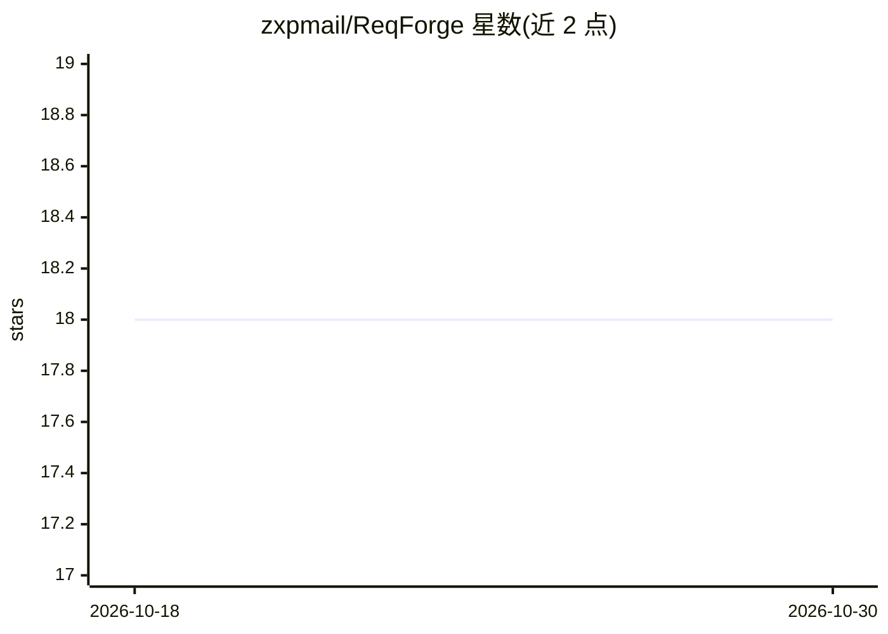

# zxpmail/ReqForge

⭐ 18 · JavaScript · MIT · 推送 2026-10-07 · [GitHub](https://github.com/zxpmail/ReqForge) · [官网](https://github.com/zxpmail/ReqForge#readme) · 个人维护 · 中文 README

**面向创始人与独立开发者的 Agent Harness：约束 Claude Code 等 AI 客户端按 Spec→Plan→Build 交付产品**

开源 Agent Harness，将 Claude Code、Cursor、OpenCode、Gemini CLI 等编码 agent 纳入受约束的工作流：通过 skills、hooks、memory 与 evolution 机制实现 Spec→Plan→Build→Review→Release 流程，含 code-review 技能、forge-verify 验证管线、证据链 trace 与技能自进化。面向 founders、PM 与独立开发者。使用方式为拷贝适配文件到项目，无需 npm 安装；Node.js+pnpm 仅供贡献者或运行脚本。棕地项目走 /change-manager。

## 筛选速览

| 维度 | 判定 | 备注 |
|---|---|---|
| AI 角色 | `ai-ecosystem` | LLM/agent 周边工具 |
| 许可风险 | `permissive` | MIT |
| 部署形态 | `library` | 以包/库形式分发 |
| 模型依赖 | — | README 未给出锁定关系 |
| 硬件要求 | — | 无带数字的原话,不猜 |
| 安装摩擦 | `low` | 无编译、无系统依赖或容器化 |
| 成熟度 | — | 结构信号不足 |

## 能力要点

- skills/hooks/memory/evolution 四层机制约束模型行为，使工作可验证
- Spec→Plan→Build→Review→Release 完整流程，棕地项目走 /change-manager
- forge-verify 多层验证管线，带证据链 trace 与 failure_class 归因
- code-review 技能：严重度/影响/置信度评分 → risk_rank，含 action 分诊

## 适用场景

- 用 Claude Code/Cursor 等 AI 客户端从需求一路推进到可发布产品
- 对 AI 生成代码做多评审员评审与验证门禁
- 管理存量（brownfield）项目的变更流程

## 场景标签

`编码 Agent` `代码审查` · 领域:编码与开发

## 证据(README 行号)

> L5: **From requirements to shippable products** — a full AI-guided path for founders, PMs, and indie developers (Spec → 
> L7: **Open-source Agent Harness** for Claude Code, Cursor, OpenCode, and Gemini CLI — skills, hooks, memory, and evoluti
> L9: **Harness in one line:** the model is the CPU; the harness is the OS — orchestration, memory, guardrails, and valida

## 星数曲线

2026-10-18 18 → 2026-10-30 18（+0）

---
*卡片 v1 · prompt 1.4 · 生成 2026-10-29 · 置信度 mid · 依据 README sha `fabd9a00a431` · [字段定义](../../DATASET.md)*
