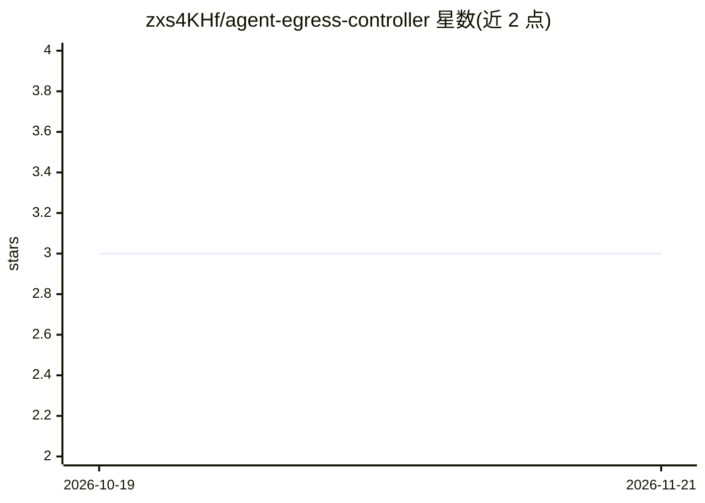

# zxs4KHf/agent-egress-controller

⭐ 3 · Rust · GPL-3.0 · 推送 2026-10-18 · [GitHub](https://github.com/zxs4KHf/agent-egress-controller) · 个人维护 · 中文 README

**让 AI 用的浏览器和 CLI 走固定网络出口的 Windows 托盘工具**

Windows 托盘程序，为 Claude Code、Codex 及 AI 浏览器提供固定网络出口：本机运行 mihomo 与 Rust relay，从托盘启动的浏览器用独立配置目录，CLI 用子进程代理变量。提供五项以上硬门槛逐项检测并输出证据（出口 IP、目标站连通、DNS 路径、时区、语言），进入前拍环境快照、退出时逐项还原时区与代理。与 Clash Verge Rev 支持系统代理共存或站点协作两种方式，可经 MCP stdio 或 loopback HTTP 供本机 Agent 读取状态与诊断。预览质量、无代码签名，仅支持 Windows 10/11 x64。

## 筛选速览

| 维度 | 判定 | 备注 |
|---|---|---|
| AI 角色 | `ai-enhanced` | 去掉 AI 部分产品仍成立 |
| 许可风险 | `viral` | GPL-3.0 |
| 部署形态 | `desktop` | 安装包/桌面程序 |
| 模型依赖 | — | README 未给出锁定关系 |
| 硬件要求 | — | 无带数字的原话,不猜 |
| 安装摩擦 | `low` | 无编译、无系统依赖或容器化 |
| 成熟度 | `idea` | |

## 能力要点

- 托盘启动的浏览器/CLI 走固定出口，退出时按快照还原时区与代理
- 硬门槛逐项检测并给证据，无证据显示「未知」不当作通过
- 与 Clash Verge Rev 2.5.8 站点协作或系统代理接管两种连接方式
- MCP stdio / loopback HTTP 接口供本机 Agent 读取状态与诊断

## 适用场景

- 让 Claude Code、Codex 等工具稳定走同一个出口而其他软件直连
- 检测并核验 AI 使用的浏览器时区、语言与出口路径
- 多端口出口故障时自动切换并有阻断保护

## 场景标签

 · 领域:网络工具/AI 工作环境

## 证据(README 行号)

> L1: Agent 出口控制器：Windows 托盘程序。让 AI 用的浏览器和 CLI 走你自己的固定出口，时区跟着对齐，五项硬门槛逐项检测并给证据，退出就还原。
> L58: - **默认只给 Agent 用的出口**：本机运行 mihomo 和 Rust relay，托盘启动的浏览器使用独立配置目录，CLI 使用子进程代理变量。可选系统代理接管让其他遵循系统代理的应用也进入这套规则。
> L162: 发布包包含 aec-agent.exe。在看板选择「Agent 接入与 MCP」并显式开启后，可复制配置到支持本机 MCP stdio 的桌面 Agent；自建本机 host 可用 loopback HTTP/JSON 接口。纯

## 星数曲线

2026-10-19 3 → 2026-11-21 3（+0）

---
*卡片 v1 · prompt 1.4 · 生成 2026-11-21 · 置信度 high · 依据 README sha `b55e66e27c23` · [字段定义](../../DATASET.md)*
