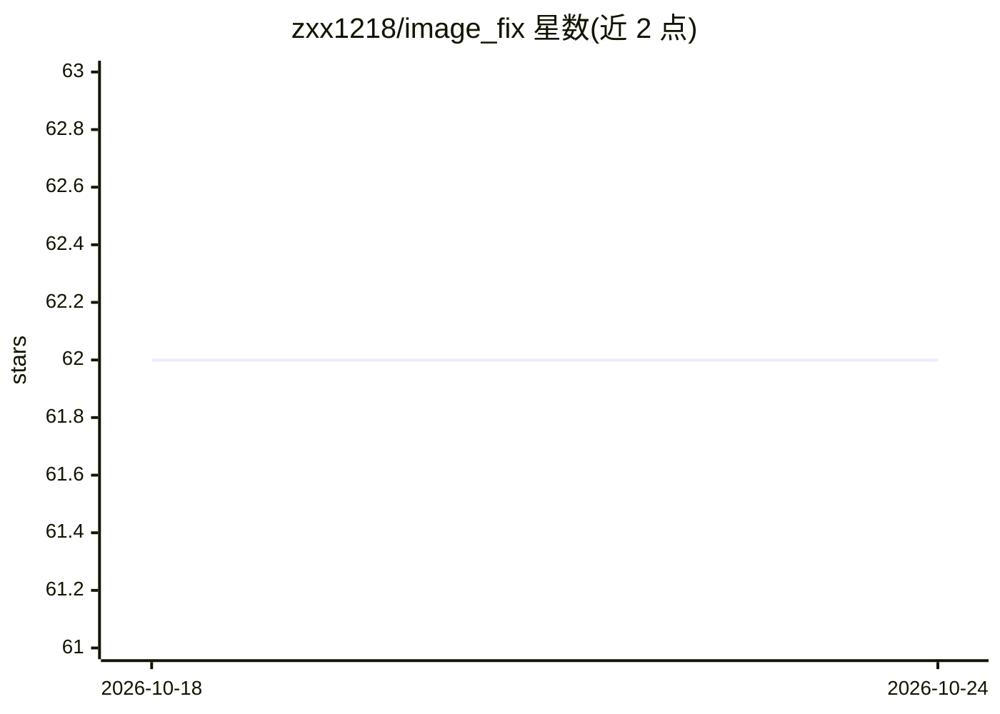

# zxx1218/image_fix

⭐ — · [GitHub]() · 个人维护 · 中文 README

**面向毕业设计的 GAN+Transformer 图像修复模型与配套应用**

基于 U-Net 形架构融合 GAN 与 ViT（Transformer）的图像修复项目：第3层集成 ViT 编解码器与多头注意力捕捉长程依赖，用 resnet-18 预提取特征降低计算量，另引入风格迁移模块与非饱和对抗损失。提供 CelebA-HQ（人脸）与 Places2（自然场景）两个预训练模型，配套 Gradio Web 端、QT 桌面应用（SQLite 内嵌、用户历史记录）与控制台批量修复三种使用方式。注意：开源代码不含模型定义源码、训练代码与 GUI 代码，完整版收费 300RMB；训练数据集与 Mask 通过百度网盘分发。

## 筛选速览

| 维度 | 判定 | 备注 |
|---|---|---|
| AI 角色 | `ai-native` | 本体是模型或模型工具 |
| 许可风险 | `none` | — |
| 部署形态 | `desktop` | 安装包/桌面程序 |
| 模型依赖 | — | README 未给出锁定关系 |
| 硬件要求 | — | 无带数字的原话,不猜 |
| 安装摩擦 | `low` | 无编译、无系统依赖或容器化 |
| 成熟度 | — | 结构信号不足 |

## 能力要点

- U-Net 形架构融合 GAN 与 ViT 多头注意力做图像修复
- 提供 CelebA-HQ 与 Places2 两个预训练模型，支持 CPU 推理（速度较慢）
- 三种使用方式：Gradio Web 端、QT 桌面应用、控制台批量修复
- 训练过程封装为脚本，两步即可训练定制模型（训练方式需联系作者）

## 适用场景

- 对人脸、自然场景等破损图像进行修复
- 作为计算机专业深度学习毕业设计的算法+应用方案
- 批量修复多张图像（控制台命令）

## 场景标签

`图像视频处理` · 领域:感知与多模态

## 证据(README 行号)

> L1: 基于深度学习技术（U-Net架构下融合生成对抗网络GAN与Transformer）的专一或多类别图像修复算法
> L58: &emsp;&emsp;本研究构建的图像修复模型创新地融合了`GAN`和`ViT`技术，采用受`U-Net`启发的`U`形架构。骨干网络的不同层级承担不同功能，第1、2层作为生成器，负责从输入图像中提取特征并进行下采样；第4、5层
> L182: - `Github`提供训练好的模型文件以及调用该文件进行修图的测试代码（`Github`开源代码中不含模型定义源码、训练代码以及`QT`的桌面端`GUI`代码，提供可供测试的模型文件，拉取`Git`代码后安装环境可进行修图测试

## 星数曲线

2026-10-18 62 → 2026-10-24 62（+0）

---
*卡片 v1 · prompt 1.4 · 生成 2026-10-24 · 置信度 high · 依据 README sha `c6780c82b221` · [字段定义](../../DATASET.md)*
