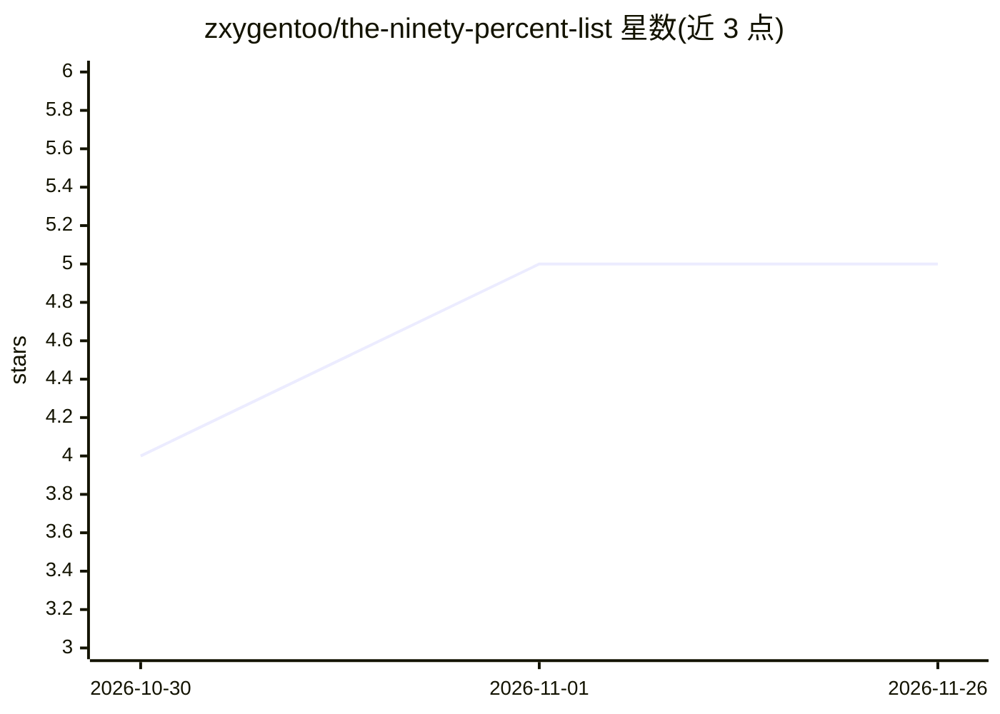

# zxygentoo/the-ninety-percent-list

⭐ 5 · Julia · MIT · 推送 2026-11-21 · [GitHub](https://github.com/zxygentoo/the-ninety-percent-list) · 个人维护

**面向学习者的机器学习论文重建清单，配 Julia/Pluto 实现笔记本**

以 Carmack 转述的 Sutskever 阅读清单为蓝本的重建版，共 31 个条目，分五个板块组织：泛化理论、设计沿革、现代训练配方、未解释现象与规模化工程。每个条目标注原始出处（arXiv/书籍/视频），其中部分条目以 Pluto notebook 形式提供最小实现与验证测量，进度为 5/31 已完成。仓库通过 GitHub Action 运行全部笔记本并导出静态 HTML 发布到 GitHub Pages，任一单元格报错则不发布。

## 筛选速览

| 维度 | 判定 | 备注 |
|---|---|---|
| AI 角色 | `ai-knowledge` | 知识聚合/清单类 |
| 许可风险 | `permissive` | MIT |
| 部署形态 | `None` |  |
| 模型依赖 | — | README 未给出锁定关系 |
| 硬件要求 | — | 无带数字的原话,不猜 |
| 安装摩擦 | `low` | 无编译、无系统依赖或容器化 |
| 成熟度 | — | 结构信号不足 |

## 能力要点

- 31 条论文/资料清单，按五个主题板块组织并标注来源
- 每条配最小实现式 Pluto notebook（Julia），含验证测量
- GitHub Action 自动运行笔记本并导出静态站点，报错即阻断发布
- 提供原始清单的 provenance 考证与修订背景

## 适用场景

- 我想按实现驱动的路径系统学习机器学习理论
- 我需要一份覆盖泛化、Transformer、RLHF 等主题的论文阅读顺序参考
- 我想在笔记本里复跑每个最小实现来理解论文

## 场景标签

`教程课程` · 领域:学习与行业

## 证据(README 行号)

> L9: Each item is worked through as a **Build**: the smallest thing to implement that forces the idea to be understood, u
> L23: Progress: **5 / 31** items built `█████░░░░░░░░░░░░░░░░░░░░░░░░░░`
> L41: - `Ilya` marks items on the original 2019–20 list, as reconstructed (see Provenance).

## 星数曲线

2026-10-30 4 → 2026-11-26 5（+1）

---
*卡片 v1 · prompt 1.4 · 生成 2026-11-20 · 置信度 high · 依据 README sha `ee6aa97fcd35` · [字段定义](../../DATASET.md)*
